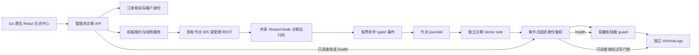

# Go 客户连接诊断详细设计

设计状态：`go-design-handoff-v1`，2026-10-22。业务与共享事件契约来自既有需求；Go 模块/管理员API/路由均为建议，须在 G0 按 [README 的 A–D 决策](README.md)核准。没有 Go 实现或现场验收结果。本文件自足描述首期行为，`references/` 用于逐字段校验与历史追溯，不能把其中 PHP 指令直接套用。

## 1. 架构、职责与隔离



控制面只传能力、通知、权威快照和ACK；日志正文不走用户同步、流量上报或业务队列。UI只访问Go API，不能获得日志库URL/凭据，也不能提交原始LogsQL。业务数据库存scope/配置与现有订单关系，Redis存短期诊断控制/快照，不存日志正文。日志服务故障局限于诊断功能，不能阻塞订单、订阅、用户同步或代理。

建议Go职责（名称可调整，禁止为结构本身做无关重构）：

| 职责 | 建议落点 | 输入/输出与边界 |
| --- | --- | --- |
| 契约与参数校验 | `internal/diagnostics/contract.go`、fixtures测试 | typed DTO、ID/时间/枚举/UTF8预算、跨仓库一致性；不访问业务库 |
| 身份与只读订单解析 | `internal/store/diagnostics_identity.go` | 参数化订单查询、分销subscriber优先、scope一次性初始化；复用现有事务/设置机制 |
| 租约 | `internal/diagnostics/lease.go`、Redis适配 | 原子并发/幂等/版本/快照；集成现有nodecoord而不另抢WS owner |
| 查询 | `internal/diagnostics/query.go`及VL客户端 | 安全编码器、共同预算、聚合、快照、游标、DNS授权展开 |
| 管理/节点API | `internal/httpapi/*diagnostics*` | 复用现有鉴权、请求上限、审计、限流与响应格式；局部错误映射 |
| 诊断映射同步 | `internal/store/RuntimeUser`和现有WS构建/协调路径 | 可选metadata、独立比较/热更新；不触发内核或业务用户重载 |
| 页面 | `web/src/features/diagnostics/`、App/Admin API类型 | 原生懒加载页面、订单快捷入口、取消请求、覆盖与调用链 |
| 诊断采集/保护 | 独立目录如 `deploy/diagnostics/` | 参考经过修正的配置；不覆盖`deploy/observability`生成的运维配置 |

本包中的建议文件尚不存在，不应当作现有可调用API。先核对现有Store/HTTP依赖组织，按最小适配落地。

## 2. 身份、初始化与业务关系

### 2.1 稳定客户身份

```text
diagnostic_id = lower_hex(SHA256("xboard-diag:v1" + NUL + panel_scope + NUL + decimal(subscriber_user_id)))[0:24]
```

`NUL`是一个0x00字节。**不能把参考文件JSON中的转义表示 `\\u0000` 或字符串 `\0` 当作散列输入的可见字符。** 以 `references/contract-fixtures.json` 的固定输入/输出断言实现。正整数用户ID使用十进制、无前导零或浮点转换；hash输入和输出大小写精确固定。

panel_scope是安装级小写UUIDv4，管理员显式幂等初始化；使用唯一持久键和原子insert-if-absent/事务，冲突后读取同一值。缺失/读取失败诊断不可用，禁止临时scope或由域名、APP_KEY、镜像SHA、当前UUID推导。普通配置保存不能改scope。独立克隆必须有独立scope与日志身份；同一安装备份恢复保留scope；用户主键不得回收给另一个客户。

Go设置键名/存储实现按现有约定选择；逻辑名称为`diagnostics_panel_scope`，是否兼容导入PHP同名键由决策A确认。查询端点/只读凭据/游标签名密钥遵循Go既有服务端配置和加密存储机制，不能通过通用设置读取接口回传秘密。scope可以向认证节点下发，不能由diagnostic_id反推。

### 2.2 订单解析

输入恰好一种：完整trade_no（trim后1–36字符，按完整字符串精确查询/比较，不转整数）或正整数order_id。分销首单/续费有关系时取其subscriber；缺失返回`subscription_user_missing`，禁止回退分销商。无分销关系时取普通订单user。客户所有订单共享ID；退款/历史订单可否查询沿用现有管理员订单权限，不能为了诊断修改订单状态。

lookup只读业务库且不依赖日志库；返回最小卡片：order_id、trade_no、order_status、order_type、customer_display_name、subscription_name、diagnostic_id。禁止UUID、token、订阅URL。订单模式每次查询/翻页/租约操作重新解析归属，不能信任先前lookup回传的客户ID。

### 2.3 连接与事件身份

连接key为`(panel_scope,node_id,runtime_id,connection_id)`。connection_id、runtime_id、resolver_operation_id为随机非零32位小写hex；span_id为16位hex；客户ID24位。已认证逻辑连接创建时冻结客户归属；UUID轮换/撤权不改变旧连接结束日志归属，但原有撤权/关闭必须继续执行。

connection类trace_id恒等于connection_id；resolver_operation类trace_id等于操作ID；node类不填虚构trace/客户。event_id为64位hex SHA256，输入为明确分隔的`panel_scope/node_id/runtime_id/event_family/owner_id/sequence`；owner分别是connection_id、resolver_operation_id、runtime_id，序号为seq、operation_seq、runtime_seq。重传不得重写event_id/event_time。

## 3. 事件、DNS与错误契约

### 3.1 三种归属类别

所有行是UTF8单行JSON，schema_version=1，必有event_time（UTC RFC3339微秒）、event_id、event_family、panel_scope、node_id、runtime_id、event。`contract-schema.json`是项目自定义契约描述，**不是声明可直接交给通用JSON Schema验证器的标准schema**；实施时按其字段、family/事件映射和预算编写验证器及fixture断言。

| family | 条件必填 | 不允许 |
| --- | --- | --- |
| connection | diagnostic_id、connection_id、seq、trace/span及连接状态；UDP目标另含target_id | 未鉴权请求伪造客户、原始user/UUID/token/订单/邮箱/源IP |
| resolver_operation | resolver_operation_id、operation_seq及操作trace/span | diagnostic_id、connection_id、session_id、等待客户/trace名单 |
| node | runtime_seq与健康/预鉴权事件字段 | 客户/连接/trace归属 |

只允许固定字段、标量和有界数组，不接受任意属性map。域名IDNA ASCII、小写、去末尾点，最多253字符；保留request/sniff/dns/unknown来源，不记录URL路径/query/headers。出站tag最多128字符；DNS答案最多8项、span_links最多4项，均有总数/截断说明。目标IP、DNS服务器与socket对端可使用指定字段；客户源IP、设备载荷和禁止的泛化身份字段不可记录。

### 3.2 事件与状态

baseline：`diag.connection.open`、`diag.admission.rejected`、`diag.route.result`、客户`diag.dns.result`、共享`diag.dns.exchange.result`、`diag.dial.result`、`diag.relay.result`、`diag.target.summary`、`diag.connection.close`。detail：`diag.route.step`、`diag.dns.attempt`、`diag.dial.attempt`。`diag.observer.health`是node类别，独立报告计数。正常baseline不抽样，满队列有明确丢弃指标。

所有目标事件保留累计`has_error`、`last_error_stage`、`last_reason_code`、`error_stages`、`reason_codes`、`transport_state`。先DNS失败再拨号失败、重试后成功都不能覆盖早期失败。TCP成功为transport_established，UDP区分socket_ready/response_observed，不能显示website_success或臆测Facebook HTTP状态。

阶段为admission/route/dns/dial/relay/close。reason_code固定为device_limit_exceeded、route_rejected、outbound_unavailable、dns_timeout、dns_nxdomain、dns_servfail、dns_transport_error、connect_timeout、connect_refused、network_unreachable、connection_reset、peer_closed、cancelled、unclassified。已知safe_message从规范字段重建，未知只保留类型和清洗后最多256码点文本；不能转发任意Error()。正常EOF不自动算故障，设备拒绝是明确业务事件。

### 3.3 Span与共享DNS

span_name固定connection、route、dns.lookup、dns.exchange、dial、relay；status为unset/ok/error/cancelled。span_duration_ms取单调时钟，不能用两个UTC相减。每个实际span有结束结果；只终止真实结束的span，重试中的子失败不能提前关闭root。relay结果先于connection.close；未进入转发不补造relay。缺parent/缺结束保留缺口，不由UI拼造。多路复用子流独立trace。

UDP共享连接root和会话relay，每target独立DNS/dial状态；最多64活动观测目标，LRU逐出先输出target.summary和原因，逐出不关闭实际转发；同地址再次出现用新target_id。TCP target_id固定0。

DNS缓存只存解析数据，不带客户context。每客户自己的dns.lookup结果单向link到独立共享dns.exchange操作；操作不含客户名单。缓存命中且无本次网络查询不产生exchange。后台刷新无客户所有者。仅SNI可见标sniff；纯IP且节点没解析标not_performed；客户端DNS为unknown。

共享操作只在至少一个仍等待且有有效detail租约的调用者存在时输出后续detail；后加入有资格者可从中途开始，标detail_started_mid_operation；资格全失效立即停detail，不补造此前步骤。详情只沿本客户dns.result实际引用的操作ID展开，禁止浏览器指定任意operation ID。

### 3.4 栈与有界异步输出

detail有效时在原goroutine的失败span首次观察/创建点捕获sidecar；捕获来源为creation_site/library_provided/observation_boundary/unavailable。Go普通error不自动携带创建栈；边界栈不冒充底层异常栈。不得改error包装、errors.Is/As、panic/recover语义，不在logger、sink或查询时抓当前栈，不转储所有goroutine。

每行连JSON与末尾换行最多4096字节；栈最多12帧、序列化后2048字节、单帧上限192字节。只保留函数、模块相对文件和行号，不保留实参、内存地址/局部变量/绝对路径。按UTF8最终序列化字节预算，字符限额用Unicode码点；先从栈尾删除完整帧，再删可选字段，保留身份/trace/阶段/分类/累计状态。仍超限输出schema合法最小错误摘要及payload_truncated=true，不能丢掉baseline错误。sidecar在事件序列化后释放。

节点队列2048条且8MiB先到限额者生效；错误/拒绝/结束保留1/4容量，detail优先丢弃，baseline错误附栈仍保留baseline优先级。代理goroutine不能等待stdout或网络；队列/丢弃指标在日志输出阻塞时仍能经控制面读取。健康每30秒，日志模块失效显示degraded，代理继续。

## 4. 用户映射、能力与双模式节点认证

在HTTP用户列表、WS full、本地direct delta、邮箱合并delta及Redis跨实例group刷新/full中下发可选diagnostic_id。诊断映射比较/更新必须在业务user hash的提前返回前执行；纯metadata变化不调用limiter.UpdateUsers、Kernel.Add/UpdateUsers、Reload或重建入站。用户删除移除映射，同时保留原有撤权、UUID轮换和强制关闭行为。

panel_scope通过认证bootstrap/权威快照单独下发，不加入触发内核重建的配置hash。缺失/冲突时停客户诊断输出，代理照常。启动/重连能力含schema_version、runtime_id、认证node_id、kernel和connection.v1/dns.v1/subject_lease.v1/exception_stack.v1。没收到能力显示unsupported，不能因字段可解析就视为支持。

沿用节点现有模式，认证分支必须在路由上显式约束：

| 节点入口 | 必要认证与授权 |
| --- | --- |
| V1 legacy诊断bootstrap/snapshot/ack | 既有shared server_token + 有效node_id；保留原广域授权，不虚称逐节点凭据隔离 |
| V2 machine诊断bootstrap/snapshot/ack | 在通用认证前要求machine_id，校验machine凭据、节点归属和启用状态；缺失machine_id拒绝，禁止降级到legacy分支 |
| WS capability/request/ack | node_id取认证连接/节点归属；另外验证当前owner/fence，不能只信消息自报node_id |

REST路径与载荷建议保持共享节点当前`/api/v1/server/diagnostics/{snapshot,ack}`、`/api/v2/server/diagnostics/{snapshot,ack}`兼容，bootstrap命名按现有节点契约核实；全部POST、请求体上限、速率限制。采集凭据是另外的每节点写入身份，不能拿machine token写日志或让viewer控制节点。

两个启动缺陷必须有真实服务构造/注册时序测试：newService需绑定实际node_id后才能健康/trace；shared WS已连接再register也要获得当前状态；disconnect→register不能重放旧connected。修复由共享节点负责人交付，Go接手者不并发改Node。G1前锁定修复SHA/兼容版本和完整测试证据。

## 5. 十五分钟租约、快照与一致性

决策B未决前不实现无Redis的隐式内存替代。建议首期Redis为权威控制状态：本地coordination不等于允许不可靠的租约状态。可选择明确配置诊断Redis，或在无Redis部署禁用start并返回稳定不可用码；该选择须G0确认，不能降低多实例安全后声称同等功能。

### 5.1 状态与键

每客户最多1有效session，面板最多10客户；session包括session_id、diagnostic_id、operator_id、created_at、expires_at、revision、enabled、当前有资格目标节点与ACK。节点集合按客户当前套餐/组/状态资格重新核对，不能只用首次使用节点。Redis TIME为共同时间基准，Lua原子维护start/stop/资格/到期清理与全局control_version。

Go Redis前缀按现有配置隔离，并包含schema/scope；以下为逻辑后缀，不能与PHP或其他环境直接共用控制键：

| 后缀 | 规则 |
| --- | --- |
| `diag:v1:control` | epoch/control_version，原子首次创建、不设TTL，version以十进制字符串传输 |
| `subject:<id>`、`session:<session_id>` | 截止或停止后24h清理，是否有效以expires_at而非键存在判断 |
| `ack:<session_id>:<node_id>` | 截止后24h，记录epoch/version/runtime/owner |
| `idempotency:<admin_id>:<key>` | 24h，标准化参数指纹，同键不同参数409 |
| `active` | 按expires_at有序集合，Lua清理并维护10客户上限 |
| `snapshot-binding:<node_id>` | 最近一次已发快照，认证主体/transport/request/runtime/epoch/version，TTL60秒 |

权威control元数据丢失时原子新建epoch、归零版本并清空活动引用，不能从残留session复活租约。Redis备份回退先重置诊断epoch；不改panel_scope/客户ID。检测Redis/控制时钟回退暂停新租约，已有节点按单调截止结束。

### 5.2 消息与应用

WS `sync.diagnostics`仅通知epoch/version变化，节点发`request.diagnostics`或REST拉取完整本节点快照。请求随机request_id并记录单调发送时间；同一节点最多一个在途请求，切换传输丢弃旧响应。

响应schema1回显request_id/runtime_id，含panel_scope、control_epoch、control_version字符串、complete=true、Redis server_time、最多10个有效sessions。每session带session_id、diagnostic_id、revision、issued_at、expires_at、max_duration_seconds=900。任何读取错误/截断都不能被当作完整空快照。完整快照缺失的session即撤销。

`diagnostics.ack`回显request_id/epoch/version/runtime及每session revision/effective/截止/拒绝原因。面板仅接受匹配最近60s绑定的ACK；只更新该次已发权威快照内且授权给该节点的session与revision，夹带未发session、跨客户session或错误revision一律拒绝，不能借合法request绑定伪造另一客户生效。WS额外验证owner。REST不claim业务WS owner；有WS owner时仅同已登记runtime可后备，否则409。纯REST以成功认证的最近快照登记runtime；旧ACK不能注册新runtime，capability自报不能替换当前owner/runtime。

节点只接受当前请求对应的权威响应。同epoch版本不回退；新epoch只来自新请求经认证完整响应，先清旧租约；同版本重投只补ACK，不延长截止。通知本身不能切epoch。

```text
remaining = max(0, min(900, expires_at - server_time - full_monotonic_RTT))
local_deadline = receive_monotonic + remaining
same_session_deadline = min(old_deadline, local_deadline)
```

RTT>5s或时间非法拒绝新detail并重拉；本机UTC不参与延长。每次发detail/附栈时重新检查租约，长连接/共享DNS不能缓存开始时资格永久生效。每30s reconcile覆盖丢通知与REST模式。

### 5.3 对外状态

start首创返回pending；同幂等或有效客户重复start返回原会话/原截止，不续期。ACK部分到达显示partial，全部有效才active。stop校验同客户同session并推进revision/control_version、保存墓碑；旧会话stop不能关闭新session。无ACK显示stopping，离线节点最晚原截止。自动到期expired；baseline继续。Redis不可用start/stop返回503而不伪报成功；**stop不依赖日志存储健康，但仍依赖权威控制状态可写**。

新建租约前1秒总时限读取私有health，不缓存ready；校验schema/scope/storage身份/state/check_age，过期/失联/blocked/unknown拒绝，稳定码diagnostics_storage_not_ready。既有幂等session返回不续期，不为了health故障把stop一同封锁。

## 6. Go 管理API与查询

管理员API放现有受保护管理前缀，复用认证与安全中间件；路径表为**建议相对路径**，须决策D按Go约定冻结，不能改全局响应语义：

| 方法/相对路径 | 输入 | 输出 |
| --- | --- | --- |
| POST `/diagnostics/initialize` | 幂等显式动作 | 同一scope与是否新建 |
| POST `/order/diagnostics/lookup` | trade_no或order_id恰一 | 最小身份卡 |
| POST `/order/diagnostics/query` | order_id或diagnostic_id恰一；from/to/filters/cursor/limit | 摘要、快照、分页、coverage |
| POST `/order/diagnostics/connection` | 同上客户模式；node/runtime/connection、时间、cursor | 连接事件及授权DNS操作 |
| POST `/order/diagnostics/start` | order_id、idempotency_key | 会话、原截止、pending |
| POST `/order/diagnostics/stop` | order_id、session_id、idempotency_key | stopped或stopping |
| GET `/order/diagnostics/status` | order_id | 各节点能力/ACK/health |

订单模式每次重解析；日志ID只读24hex且强制当前服务端scope，不反查全部用户/哈希、不新增历史映射表，不能start/stop/status。两模式connection均重新校验属于选定客户。审计记录操作者、订单、时间/过滤和会话标识，不记录查询响应正文、秘密或UUID；status轮询不逐次写审计。

诊断局部稳定错误码应由Go既有错误响应扩展承载（建议error.code），G0锁定类型及TypeScript解析；不得修改全局业务API外层。至少覆盖：未认证/无权限、invalid_lookup_input、order_not_found、subscription_user_missing、diagnostics_not_initialized、scope读取/格式错误、diagnostics_storage_not_ready、控制服务不可用、idempotency_conflict、lease_limit_reached、snapshot/owner/runtime冲突、cursor_expired/cursor_invalid、backend_unavailable/backend_timeout、rate_limited。HTTP分别使用401/403、422、404、409、503、429/409等恰当状态；后端超时504，不能统一吞成200空列表。

### 6.1 查询字面量与共同预算

默认from为当前前15min，最长72h，from<to且to不超服务端当前时间。域名只允许exact/suffix/contains，默认contains，最多253码点；不接受正则、控制字符或LogsQL。专用编码器构造字面量；scope、客户和精确trace_id（32hex）首先下推，不能先读取一万条客户日志再内存筛trace。

固定VL版本的`/select/logsql/query`语法由真实隔离集成测试锁定。读取原始事件倒序，按event_id去重，以(node,runtime,connection,target_id)聚合最大seq自包含摘要；随后在有界集合内过滤累计错误和域名。UDP close附属于连接不覆盖各target。不得扫描72h全部连接做无界高基数聚合。

| 预算 | 首期默认契约 |
| --- | --- |
| 查询原始读取 | 每请求总计10000行或16MiB，先达到者；连接和DNS共用 |
| 时间 | connect<=1s；上游执行<=4s；整个API<=5s，父context取消传播 |
| 列表分页 | 默认100条、最多200条 |
| 列表快照 | 聚合最多1001个摘要，前1000生成只读快照，额外1判断截断；快照<=2MiB |
| 详情返回 | 合计<=1000事件或2MiB，DNS不另获一份预算 |
| DNS展开 | 每页最多32个已授权操作ID，一次有界批量展开，禁止N+1 |
| 快照缓存 | TTL5min，每管理员最多3个；列表/详情共享上限 |
| 资源限流 | 每管理员最多2并发查询、每分钟60次；服务端全局资源上限按运行容量另锁定 |

读取/聚合/响应任何上限触发均显示scan_truncated或truncated及原因。无结果但扫描截断不能解释成无匹配访问。部分上游结果必须partial；错误不能当成功空集。

### 6.2 快照和游标

有界读取后按最后事件时间及完整连接身份稳定排序建立只读快照，不用裸offset追逐晚到数据。签名不透明cursor绑定admin、模式、可选order、scope、客户、标准化filters、时间、storage_generation、快照ID和位置。翻页重新认证并重解析归属；字段改变或伪造拒绝，过期cursor_expired。刷新创建新快照纳入晚到记录。

详情游标另绑定node/runtime/connection和已授权DNS展开进度，但共用每管理员3个/5min上限；不能让用户提交任意resolver_operation_id。只沿该客户dns.result取得ID，按scope/node/runtime与ID批量展开；操作事件没有客户身份也不能绕开这一步授权。按seq呈现连接事件，共享DNS附在对应结果下。窗口外起点、父span/事件缺失分别说明。

首期一个可配置查询端点；浏览器不能选端点，SSRF防护采用服务器受信配置。变更端点/来源/重要查询语义提高storage_generation使旧cursor失效。后续双源才实现总10000行/16MiB/5s、每源5000行/8MiB共同预算、完整时间范围去重，不按切换时间裁断event_time。

## 7. 采集、身份强制、存储guard与健康

Go现有运维栈30天保留、30GiB告警且writer可自报其他source，不能直接用于客户隔离。诊断必须独立数据/卷、凭据、Vector data_dir与buffer、sink及保留设置；可复用生成器思路和已修正逻辑，不复制真实配置或秘密。共享主机不是长期生产容量承诺。

Vector按三类family白名单保留字段，禁止转发原始message；无/非法/明显异常event_time计数并抑制，不回退入库时间。强制_time_field=event_time，额外collected_at只表示采集时间。schema非法抑制并计数，不能静默改成成功字段。event_id主要去重，journal cursor hash辅助。

每节点独立writer，同机多节点拆sink。鉴权服务端固定extra_fields内scope/node/collector及时间/stream/tenant规则，正文伪造被覆盖或拒绝；拒绝重复身份query、debug/任意header覆盖，必须固定版本负面验证。writer只允许insert，viewer只允许受限query与GET /diagnostics/health；均不得修改guard。运维管理恢复身份独立，不进浏览器。不能只凭token不同宣称隔离。

单一轻量guard处理检查、写入门禁和健康；鉴权后写入经guard，查询绕过写门禁。guard退出/检查失效/锁存时写入503而非伪成功。检查用单调年龄，状态放独立受限state目录，不依赖故障数据卷。每30秒检查、每请求核验检查<=60秒；未知或陈旧即拒写，转发请求体/超时有界，不另建无界重试队列。

只读health至少含schema_version、panel_scope、storage_id、state(ready/blocked/unknown)、reason_codes、checked_at_utc、check_age_seconds、latched、data_used_bytes/data_available_bytes/root_available_bytes。面板验证身份和服务提供的单调年龄，不能用两机UTC差判断健康。

### 7.1 参考试点预算，G0须复核目标

以下是原单节点共享开发机试点预算，**不是已批准的Go容量/主机规格，也未实测证明足够**：30GiB真实预分配ext4独立文件系统、3天目标保留；VL 1CPU/1.5GiB、guard0.25CPU/64MiB、Vector1CPU/384MiB，节点sink独立2GiB持久buffer。根盘分配后至少保留max(50GiB,20%)。不稀疏预分配、不覆盖已有目标；启动/重启前检查真实挂载、ext4、UUID和设备身份，不能自动落回根盘空目录。

| 参考条件 | 行为 |
| --- | --- |
| 使用>=16GiB或四日分区预测达到此值 | 预警、停止扩范围，评估独立主机 |
| 使用>=20GiB | capacity_critical；参考VL配置同时以`retention.maxDiskSpaceUsageBytes=20GiB`作为容量清理软目标，按日分区清理，最新分区过大可超目标；阈值本身不证明历史已删除 |
| 使用>=24GiB、可用<=6GiB、根盘低保护线或挂载失效 | guard写入503并持久锁存，阻止新detail；可用的只读查询保留 |
| 可用<=5GiB | 存储引擎紧急保护，不能越过guard硬灌 |
| 已证实提前清理允许窗口内历史 | retention_shortened及影响范围；partial，范围无法确定则unknown |
| buffer>=1GiB或可查询延迟连续5min>60s | 积压预警；>=1.8GiB严重；2GiB满后源journal仍可能淘汰 |

20GiB软清理目标不构成硬磁盘配额，30GiB独立文件系统才是参考硬边界；具体固定VL版本的清理行为须用T17证明。保护恢复需原因排除、挂载/容量/速率/积压/缺口核验及显式resume，不自动解除锁存、扩容或删其他项目文件。时限按原event_time，不因补传/迁移续命；不承诺每条恰好72h物理删除，不额外备份/全量导出客户日志。

### 7.2 覆盖与观测证据

分别保存三种来源：节点observer运行/丢弃计数、collector cursor/buffer/error、日志库健康/可查询canary。每项带测量时间和时效，任一未知不能假设完整。HTTP成功不是逐行持久化确认，要查看拒绝计数并查到业务事件。

coverage状态：可确认正常覆盖为complete（只描述已验证范围，不承诺绝对无丢失）；事件完整缓冲但迟到为delayed；已知队列/journal/永久拒绝/提前清理缺口为partial；无法确认健康、范围或完整性为unknown。unsupported/offline/degraded作为节点能力/状态及reasons细分，不能与“无匹配记录”混为一类。只读ID无法推断客户节点全集时unknown。显示“所选范围没有收到匹配记录”，不能显示“客户未访问/访问正常”。

## 8. React交互

新增原生AdminPage/route/lazy module/API types，位置临近Dashboard；订单入口只带order_id，不在URL放UUID/token/订阅链接。路由命名G0确认；不要求PHP的hash query扩展方式。组件建议为查询条件、身份卡、覆盖/存储状态、目标表、连接事件/调用链、DNS/异常栈、租约面板，采用现有主题和响应式组件。

订单模式status每5秒轮询，后台标签页/离开中心停止该轮；不改变既有Dashboard轮询。切客户、查询模式、过滤、trace或分页时AbortController取消旧请求，并用请求generation拒绝迟到响应；清空旧trace/cursor/coverage。认证失效立即清数据、终止查询/轮询。日志纯文本渲染，不用innerHTML；桌面1440与窄屏390、键盘焦点、刷新/前进后退验证。

离开页面不自动stop；start后显示pending/节点数/原截止，stop显示stopping和离线截止。来源不明栈、缺父span、窗口外连接、延迟和截断有明确文案。API失败不让订单页或导航整体卡死。

## 9. 迁入、发布与回滚设计

### 9.1 独立Go安装

使用独立scope/Redis前缀/采集writer/读凭据/卷与环境身份；只用合成客户起步。不能复制PHP生产settings、scope、machine9/真实节点或QA凭据，不共用历史用户主键命名空间来“自动关联”。

### 9.2 接替PHP安装（决策A确认后单独实施）

1. 在隔离副本上核对订单/实际subscriber映射、用户ID保持策略和scope唯一性；证明诊断ID对固定样本一致，ID被重映射时不得假装同一历史身份。
2. 清点旧诊断库、源时间窗口、storage_id/generation、只读/写身份和collectors，记录目标状态与回滚点，不导出真实日志到仓库。
3. 通过获批迁移工具导入已验证scope与业务关系，不迁入有效Redis诊断租约。停止或等原租约到期，建立新控制epoch，安排单一权威控制面接管，不能两面板并发控制同节点。
4. 若授权继续查旧历史且可信身份一致，先用只读来源验证；改变来源提高storage_generation。数据身份/存储不兼容时明确历史范围断点，不进行按UUID猜测补映射。
5. 面板/节点分阶段兼容发布，固定制品与真实订单/新连接验收；回滚保留scope和历史卷，不恢复过期租约。

该流程不是本包执行授权。若需业务数据结构迁移，使用Go既有schema版本/离线迁移机制，写出备份、幂等、失败回滚和兼容性证据；不能未经审查自动改真实库。

### 9.3 后续独立日志主机迁移

首期交付稳定单端点/身份/generation及手册。P1容量报告后再开发D7.3双源。M1新库身份/容量/权限验证；M2面板暂查两源；M3旧入口受控转发到唯一新写入目标；M4逐采集器切端点保留sink ID/data_dir/cursor/buffer/event_id；M5核对离线采集器、在途与积压；M6在旧库最后接收时间与最大event_time较晚者后至少72h确认窗口排空再移除旧查询；M7独立授权退役旧资源。禁止长期双写、转发循环或因新库失败默默写回两库。回切需容量正常和单一目标，任一来源故障partial；不删原运维日志或开发项目。

所有环境依当前Go规则只经CI/CD；现有observability验证工作流不等于新诊断部署入口，固定其他主机的旧logging-runner不得直接复用。先审查触发器/权限/环境/产物与回滚，再提出可审查变更；本包不修改工作流或触发部署。候选使用完整SHA/不可变摘要，验收分别核对CI、制品、运行版本和业务事实。

## 10. 性能和容量验收目标

相同条件比较原基线、baseline、detail三组；含正常连接、高频失败抓栈、TCP/UDP/DNS与共享解析。既有需求预算：baseline吞吐下降<=5%，连接建立P95增量<=5ms；这是验收目标，未有Go测量结果。队列满/stdout阻塞/日志库失联时代理仍满足其原业务语义。

P1另测事件速率/字节、压缩数据与索引、合并临时空间、CPU/内存/I/O、buffer、丢弃/拒绝、可查询P95和过滤查询P95。参考目标：正常可查询P95<=10s、查询P95<=3s且总时限5s，无持续积压/新增OOM/已知丢弃/业务回归，四日分区外推<=16GiB。24–48h实测不能代替自然3天过期测试；隔离门禁与过期测试单列。

容量按实测估算：日原始字节=每秒连接数×每连接事件数×平均事件字节×86400，另计共享DNS/健康；不能把事件数当连接数或假设压缩比。独立主机下限参考`(全节点预计每日压缩数据及索引×4 + 实测合并临时空间 + buffer/组件日志预算)/0.8`，CPU/内存/网络按峰值和查询并发实测；达到预警先评估迁移再扩节点。