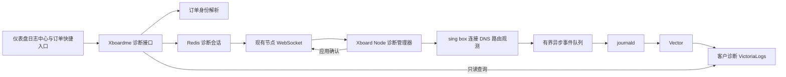

# 客户连接诊断详细设计

状态：技术负责人设计复核通过，可开始本地开发，尚未实现或部署。日期：2026 年 10 月 18 日。

交接版本：`2026-10-18-review1`。详细设计、开发任务书和开发提示词须成套使用。

本功能把订单、实际订阅用户、节点连接和故障事件关联起来。管理员从仪表盘进入日志中心，输入完整订单号，即可查询目标域名、节点实际执行的 DNS 解析、设备限制拒绝、出口、调用链和连接错误；订单详情提供同一日志中心的快捷入口。第一版开发 Xboardme、Xboard-Node 及其仓库内 sing-box 观测接口，复用 Vector 和 VictoriaLogs 的采集存储方案。

本设计不授权修改生产数据、升级节点或触发部署。现有面板发布流水线保持不变；日志基础设施缺少获批发布入口，作为独立上线阻塞项处理。

2026 年 10 月 18 日补充决定：先使用开发测试服务器 `bingo-dev` 做一台节点的日志试点，观察二十四至四十八小时，再根据实测容量决定独立日志服务器规格。本次授权只补充设计；试点部署、节点接入和后续迁移均尚未执行。

开发交接以本设计、[开发任务书](customer-connection-diagnostics-development-plan.md)和[开发提示词](../handoffs/customer-connection-diagnostics-developer-prompt.md)共同为准。技术负责人复核已补齐双模式节点鉴权、span 结束、热更新与撤权、入库门禁健康、日志 ID 只读查询和 DNS 查询总预算；双源迁移实现后移。以下功能均尚未实现。

## 一 交付范围与完成条件

| 项目 | 第一版交付 |
| --- | --- |
| 用户入口 | 仪表盘日志中心输入完整订单号，或使用已有客户日志 ID 只读查询；普通订单详情、分销订单列表及详情快捷进入同一中心 |
| 查询对象 | 订单对应的实际订阅用户，覆盖续费订单；管理员可在当前 panel_scope 查询客户，详细租约操作必须绑定订单 |
| 节点范围 | 当前使用 sing-box 的节点；TCP、UDP 和实际启用的多路复用协议均纳入协议验收 |
| 常规记录 | 目标、路由、节点 DNS 结果、拒绝与连接失败、连接状态和结束摘要 |
| 详细诊断 | 指定客户开启十五分钟详细事件，显示各节点确认状态，到期自动结束 |
| 调用链与堆栈 | 节点内 trace/span 父子关系、阶段耗时及结果；详细诊断时记录实际捕获且注明来源的异常栈 |
| 历史查询 | 最近七十二小时，支持域名、节点、错误阶段、结果筛选 |
| 采集状态 | 区分无匹配记录、节点不支持、节点离线、采集延迟和已知记录丢失 |
| 客户端 | 不修改 Clash Mi；客户端本地解析与未到达节点的请求不伪装成节点观测结果 |

验收必须证明：同一客户跨节点、UUID 重置、分销续费后仍关联正确；不同客户查询同一域名不会串日志；设备限制、DNS 失败和拨号失败能从订单定位；日志系统中断不会阻塞代理连接。

第一版不提供 Xray 观测、不开放分销商自助查看、不读取 HTTP 请求内容、不补造历史上未记录的数据。普通订单列表来自独立构建的后台子模块，第一版通过普通订单详情进入，避免为一个按钮修改已有构建产物。

## 二 现有实现与改动依据

以下是本地源码基线，不代表生产运行版本：Xboardme `cbc4d54618ba81e6965dcf791901cf7bdd534422`；Xboard-Node `cb5e1521d0d332bc3c0a115ca79ba85288c9ab9d`。开发启动时重新核对基线及未提交改动，不覆盖现有后台子模块改动。

| 已有实现 | 对设计的约束 |
| --- | --- |
| [订单详情](../../app/Http/Controllers/V2/Admin/OrderController.php) 使用分销关系中的 subscriber，普通订单才使用 order.user | 统一提取身份解析服务，禁止把分销商当成客户 |
| [节点全量用户](../../app/Services/ServerService.php) 与 [增量同步](../../app/Services/NodeSyncService.php) 都包含用户 ID | 两条路径同时加入诊断 ID；不能只修改其中一条 |
| [NodeRegistry](../../app/Services/NodeRegistry.php) 可以发送节点消息 | socket 发送成功不表示节点应用成功，需要应用确认 |
| [NodeWorker](../../app/WebSocket/NodeWorker.php) 已有单节点、machine 连接身份及 owner 检查 | 新诊断消息复用这些身份边界，不能信任消息自报的 node_id |
| [连接 tracker](../../../Xboard-Node/internal/kernel/singbox/conntracker.go) 已能解析已鉴权用户 | 复用真实身份适配，不能对所有协议直接哈希 metadata.User |
| [sing-box 路由](../../../Xboard-Node/deps/sing-box/route/route.go) 在 tracker 前执行 DNS 和部分拒绝 | 诊断上下文必须在路由入口建立，不能只改 tracker |
| [内核实例](../../../Xboard-Node/internal/kernel/singbox/singbox.go) 的部分重建路径使用 NOP logger | 专用 observer 必须随内核初始化和重载正确注入，不依赖普通日志器 |
| [通用日志脱敏](../../../Xboard-Node/internal/nlog/structured.go) 会过滤 IP，error 对象只保留类型 | 增加类型明确的诊断事件接口，不放开全局脱敏规则 |
| [采集配置](../../../Xboard-Go/deploy/observability/configure.py) 已有 Vector、缓冲、鉴权和字段白名单 | 复用实现，新增诊断字段及路由；现有部署范围不等于这两台节点已接入 |

## 三 架构与职责



控制消息走现有节点控制通道。日志正文走采集通道，不通过节点用户同步、流量上报或业务队列传输。面板查询服务访问日志库；浏览器不持有日志库凭据。日志库停机时，订单、订阅、用户同步和代理业务保持各自原有行为，诊断接口返回明确故障状态。

### 日志 ID 与连接 ID

客户身份统一命名为 `diagnostic_id`，界面标签为“客户日志 ID”。

```text
diagnostic_id = lower_hex(SHA256("xboard-diag:v1\0" + panel_scope + "\0" + decimal(subscriber_user_id)))[0:24]
```

`panel_scope` 是安装级随机 UUID，存放既有 `v2_settings` 的 `diagnostics_panel_scope` 键。通过管理员显式初始化接口一次性创建，使用 name 唯一约束解决并发初始化，冲突后读取同一值。该值不能由域名、APP_KEY、镜像版本或当前 UUID 推导；普通设置保存不能修改它。设置缺失或读取失败时，诊断功能不可用，禁止生成临时替代 ID。备份恢复必须保留 scope；独立克隆环境使用自己的 scope 和日志存储身份。禁止复用旧用户主键指代另一个客户。

身份解析规则按以下顺序执行：

1. 存在分销首单或续费关联时，取关联 subscriber。
2. 分销关系存在但 subscriber 缺失时，返回 `subscription_user_missing`，不能回退到分销商。
3. 无分销关系时取普通订单 user；用户缺失返回相同错误。
4. 同一实际用户的所有订单共享诊断 ID；订单是查询入口，不是节点记录的归属依据。

`connection_id` 为节点生成的随机一百二十八位值，以三十二位小写十六进制存储。连接身份键为 `(panel_scope, node_id, runtime_id, connection_id)`。已鉴权身份在逻辑连接建立时冻结；UUID 后续轮换不能重新解释已有连接的归属。

连接事件有连接内递增 `seq` 和全局 `event_id`；其他事件使用所属操作或运行实例的序号，具体规则见事件分类。采集重传必须保留原 event_id。旧日志的 UUID 哈希不是新 diagnostic_id，界面不混用；第一版不自动补旧 UUID 的历史映射。

`diagnostic_id` 表示客户，`trace_id` 表示一次逻辑代理连接，`span_id` 表示该连接内一个操作，`event_id` 表示一条日志。订单用于解析客户，不能把订单号当 trace。connection 类的 trace_id 恒等于 connection_id，避免额外维护第二套连接映射。

## 四 节点用户同步与能力协商

面板的 HTTP 用户拉取、WebSocket 全量同步、分组同步、增量同步统一增加可选 `diagnostic_id`。诊断身份只对已认证的节点连接或已有节点 API 下发。

节点改动覆盖 Panel User DTO、UserSpec、两个方向的转换、HTTP 拉取、WS full、直接 delta 和邮箱合并后的 delta。诊断映射比较和更新必须在现有业务 user hash 的提前返回之前执行；纯诊断变化不调用 limiter.UpdateUsers、Kernel.AddUsers/UpdateUsers、Reload 或重建入站。业务用户配置版本和诊断映射版本分开维护，避免既漏更新又触发业务重载。

删除用户时移除诊断映射，但原有 RemoveUsers、会话撤权、UUID 轮换和强制关闭行为必须照常执行。冻结的是日志归属，不是用户权限；被撤权连接的结束事件仍使用建立时冻结的身份。

节点启动及重连上报 `diagnostics.capabilities`，字段包含协议版本、运行实例、节点 ID、内核类型和能力列表。第一版能力为：

```json
{
  "schema_version": 1,
  "runtime_id": "0123456789abcdef0123456789abcdef",
  "capabilities": ["connection.v1", "dns.v1", "subject_lease.v1", "exception_stack.v1"],
  "kernel": "singbox"
}
```

connection.v1 包含本设计 trace/span 与连接生命周期，dns.v1 包含 lookup、实际 exchange 摘要及授权 link；exception_stack.v1 表示实现了来源明确的栈捕获，不表示每个错误都有创建点堆栈。旧节点忽略用户列表的新字段；面板没有收到诊断能力时显示“不支持”。新节点连接旧面板、缺少 diagnostic_id 时不伪造稳定客户身份。旧协议的正常代理业务不因诊断字段缺失而被拒绝。

WS capability 和 ACK 的 node_id 由已鉴权连接及当前 owner 确认；machine 凭据只能代表实际归属该 machine 的节点。旧 shared server_token 模式沿用其现有广域授权，owner 校验仅防止旧连接覆盖新连接，并不把共享 token 变成每节点独立凭据。REST 的两个鉴权模式及 ACK 绑定见第七节；旧进程的迟到 ACK 不得覆盖新 runtime。

`panel_scope` 通过经鉴权的诊断 bootstrap 和权威快照单独下发，不加入触发内核重建的配置 hash。节点不能由 diagnostic_id 反推 scope；缺失或来源冲突时暂停客户诊断输出，代理继续运行。初始化 scope 后，用户映射与诊断元数据都需热同步。

## 五 诊断事件协议

### 公共字段

事件使用单行 JSON，schema_version 固定为 1。所有事件必有 event_time、event_id、event_family、panel_scope、node_id、runtime_id、event。客户与连接字段仅在 connection 类别必填，不能给无客户事件填虚构身份。

| event_family | 条件必填字段 | 禁止混入的归属 |
| --- | --- | --- |
| connection | diagnostic_id、connection_id、seq；UDP 目标事件另有 target_id | 未鉴权用户不能使用此类别 |
| resolver_operation | resolver_operation_id、operation_seq | 禁止 diagnostic_id、connection_id 和客户名单 |
| node | runtime_seq；健康或预鉴权事件类型 | 禁止伪造客户和连接归属 |

event_id 为 SHA256 的六十四位十六进制值：对明确分隔的 `panel_scope/node_id/runtime_id/event_family/owner_id/sequence` 编码求哈希。connection 的 owner_id 为 connection_id，resolver_operation 为操作 ID，node 为 runtime_id；sequence 使用各类别对应序号。下表描述 connection 类别公共字段，其余类别共享适用字段并按上述条件校验。

| 字段 | 类型与限制 | 语义 |
| --- | --- | --- |
| `event_time` | UTC RFC3339，带微秒 | 节点观察时间 |
| `event_id` | 64 hex | 去重身份 |
| `panel_scope` | UUID | 面板安装范围 |
| `diagnostic_id` | 24 hex | 已鉴权订阅用户身份 |
| `node_id` | 正整数 | 面板节点 ID |
| `runtime_id` | 32 hex | 本次节点进程实例 |
| `connection_id` | 32 hex | 逻辑代理连接 |
| `seq` | 正整数 | 同一连接的事件顺序，不以到达顺序代替 |
| `event` | 枚举 | 事件种类 |
| `stage` | 枚举 | admission、route、dns、dial、relay、close |
| `network` | tcp 或 udp | 逻辑流量类型 |
| `requested_host` | 规范化域名或 IP，最多 253 字符 | 客户提交的目标 |
| `requested_port` | 1 到 65535 | 目标端口 |
| `observed_domain` | 可空域名 | 实际可观察域名 |
| `domain_source` | request、sniff、dns、unknown | 域名来源，不把猜测写成 request |
| `outbound_tag` | 最多 128 字符 | 选中出口 |
| `selected_target_address` | 可空 IP | 出站逻辑所选目标 |
| `socket_peer` | 可空 IP 和端口 | 实际 socket 对端，可能是上游代理 |
| `session_id` | 可空 32 hex | 产生详细事件时对应的诊断会话 |
| `observation_mode` | baseline 或 detail | 本条事件记录模式 |

传输字段只使用允许的标量与有界数组；span_links 等结构数组必须具有固定字段，禁止任意属性 map。域名规范化采用 IDNA ASCII、小写、去除末尾点，不能写 URL、路径、查询参数或任意 headers。目标 IP、DNS 地址可以保留；客户源 IP 如需关联只保留指纹。单条事件连同 JSON 序列化和末尾换行上限 4096 字节，地址数组最多八项，超出时记录总数与截断标记；丢字段不能破坏合法 JSON。

所有连接目标事件携带已知目标字段和累计状态：`has_error`、`last_error_stage`、`last_reason_code`、`error_stages`、`reason_codes`、`transport_state`。error_stages 与 reason_codes 是固定枚举集合，不使用无限增长字符串。一个重试最终成功的目标仍保留 has_error=true；先 DNS 失败再拨号失败时，两个错误阶段均可筛选。UDP 累计状态分别归属 target_id，不能以最后一个目标覆盖此前目标。

### 事件与记录模式

| 事件 | 模式 | 触发点与额外内容 |
| --- | --- | --- |
| `diag.connection.open` | baseline | 路由入口，已鉴权身份确定，记录目标 |
| `diag.admission.rejected` | baseline | 真实设备门禁等拒绝点；reason_code、device_limit、active_ip_count |
| `diag.route.result` | baseline | 选中出口或路由失败；rule_id 如可用 |
| `diag.dns.result` | baseline | 每个调用者的 DNS 结果、缓存命中、rcode、答案、耗时 |
| `diag.dns.exchange.result` | baseline | resolver_operation 类，实际解析操作结束的 root 摘要、耗时及结果，不含客户身份 |
| `diag.dial.result` | baseline | 每次目标连接成功或失败、attempt_id、耗时 |
| `diag.relay.result` | baseline | 实际转发结束的 relay span 结果，先于 connection.close；未进入转发不伪造此事件 |
| `diag.target.summary` | baseline | UDP 观测目标逐出或会话结束的累计摘要，summary_reason 为 lru_evicted 或 session_closed；逐出不代表真实转发被关闭 |
| `diag.connection.close` | baseline | 结束一次；duration_ms、bytes_up、bytes_down、close_reason |
| `diag.dns.attempt` | detail | 具体解析器、传输协议、尝试序号、开始结束及结果 |
| `diag.route.step` | detail | 允许列表内的路由决策步骤 |
| `diag.dial.attempt` | detail | 地址选择、回退、重试细节 |
| `diag.observer.health` | 独立健康事件 | 队列、丢弃计数、observer 状态和当前控制版本 |

不逐数据包记录，不持续记录相同状态。baseline 正常负载下不抽样；超过队列容量时显式记录丢弃计数，不能承诺无条件完整。模式和队列优先级由事件类型决定：detail 租约允许 baseline 错误事件附带栈，但不能把该错误事件降成 detail 优先级。长连接没有结束事件只表示“尚未观察到结束”，不能据此认定现在仍在线。

### 错误模型

错误使用 `reason_code`、`error_type`、`timeout`、`errno`、`dns_rcode`、`safe_message`。已知错误的 safe_message 从规范字段重建，不直接输出任意 `Error()`。未知错误保留类型与 `unclassified`；只允许经过统一清洗、限长到 256 字符的补充文本。

首批 reason_code：`device_limit_exceeded`、`route_rejected`、`outbound_unavailable`、`dns_timeout`、`dns_nxdomain`、`dns_servfail`、`dns_transport_error`、`connect_timeout`、`connect_refused`、`network_unreachable`、`connection_reset`、`peer_closed`、`cancelled`、`unclassified`。正常 EOF 不自动标成故障；设备拒绝必须是明确业务事件，不靠结束错误猜测。

TCP 成功状态为 `transport_established`，不命名为 website_success。UDP 区分 socket_ready 与 response_observed。节点转发的加密应用连接不能据此产生 Facebook HTTP 状态码。未经鉴权的失败不附客户 diagnostic_id，作为节点级事件单独查询。

### 调用链与异常堆栈契约

采用 trace/span 的关联模型，把字段写入现有结构化事件，第一版不新增 OTel Collector、Jaeger 或独立 trace 存储。调用链只覆盖节点实际执行的处理，不能声称获得手机客户端、Facebook 内部或未接入组件的调用链。[Trace 与 Span 模型](https://opentelemetry.io/docs/concepts/signals/traces/)

| 字段 | 固定语义 |
| --- | --- |
| trace_id | connection 类等于 connection_id；resolver_operation 类等于 resolver_operation_id；均为非零 32 位小写 hex。node 类不伪造 trace |
| span_id、parent_span_id | 非零 16 位小写 hex；同 trace 内唯一，root 的 parent 为空 |
| span_name | connection、route、dns.lookup、dns.exchange、dial、relay 固定枚举 |
| span_start_time、span_duration_ms | 开始 UTC 时间、单调时钟测得的耗时；耗时不能用两个 UTC 时间相减 |
| span_status | 项目枚举 unset、ok、error、cancelled，表达该操作结果，不代表网站整体可用 |
| span_links | 最多四项，每项限定 trace_id、span_id、relation；共享 DNS 的 relation 为 shared_dns_operation |
| build_revision | 完整节点提交 SHA；开发样本未绑定构建时为 null，并标明源码位置无法精确归版，不能伪造版本 |

每个已鉴权逻辑连接创建 connection root，按真实 context 形成 route、DNS、dial、relay 的父子关系。DNS 可能嵌套于 route 或 dial，不能为绘图硬编码顺序。open/close 对应 root 开始/结束，result 事件携带对应 span 的开始时间、耗时和结束结果，不额外复制一套 baseline start/end 日志；detail attempt/step 归属相应子 span。每个实际建立的 span 都有明确结果事件，丢弃时计入缺口，不由 UI 补造结束。多路复用子流各有自己的 trace；UDP 共享连接 root 和会话级 relay span，各 target_id 的 DNS、dial 使用独立 span，不逐包建 span。

共享 DNS 操作有自己的 dns.exchange root 和 trace，以 diag.dns.exchange.result 结束，不归属任何客户。客户自己的 dns.lookup 结果通过单向 span_link 引用操作 root；操作事件不能反向列出客户 trace 或名单。连接详情只沿本客户已有 dns.result 的授权引用展开。缓存命中而没有本次网络解析时不生成虚构 exchange span；中途开启 detail 时允许父节点记录缺失，界面显示“父操作记录未采集”，不能拼造父 span。仅凭按时间排序的日志列表不能标记调用链完整。

错误字段增加 exception.type、exception.message、exception.stacktrace、exception.stack_capture_kind、exception.stack_truncated、exception.stack_frames_total，使用固定 JSON 字段；type/message 与现有规范 error_type/safe_message 同源。Go 普通 error 不自动携带创建时堆栈。stack_capture_kind 固定为 creation_site（确实在自有创建位置）、library_provided（库已提供可验证栈）、observation_boundary（首次观察错误的边界）或 unavailable。界面按来源标注，边界栈不能标成底层原始异常栈。[异常堆栈字段语义](https://opentelemetry.io/docs/specs/semconv/exceptions/exceptions-logs/)

只有有效 detail 租约下，每个失败 span 的首次捕获点，才允许在原 goroutine 同步捕获栈并存入诊断 sidecar；不改变原错误对象、包装层、errors.Is/As 或 panic/recover 行为。禁止在 logger、异步 sink 或查询接口里抓当前栈冒充异常栈，禁止转储所有 goroutine。正常 EOF、设备限额拒绝不伪装为程序异常。未开启或已过期租约的 baseline 仍记录错误原因与阶段，栈为 unavailable，不事后补造。

栈最多十二帧、该字段序列化后最多 2048 字节，同时受事件总计 4096 字节限制。只保留函数、模块相对文件和行号，不含实参、局部变量、内存地址、主机绝对路径。先保留身份、trace/span、阶段、错误分类和累计状态，再从栈尾按完整帧削减、去除可选字段并设置截断标记；仍超预算时输出 schema 定义的最小错误摘要与 payload_truncated=true，不能丢掉错误而只留 detail 或破坏必填字段。D1 必须验证最大长度的必填组合也能容纳于 4096 字节；字段字符限制按 Unicode 码点，事件与栈预算按最终 UTF-8 JSON 字节计，不能直接截字节造成非法 UTF-8 或 JSON。stack_frames_total 仅表示实际捕获得到的帧数。sidecar 在对应事件序列化后释放，不把栈积压到长连接结束。共享 DNS 的捕获按第六节租约资格规则执行，栈也不携带客户归属。

## 六 sing box 埋点与生命周期

在仓库内 sing-box 的独立公共包定义无业务依赖的 `Observer`、`Trace`、`Event` 类型，避免 DNS、adapter、route 间循环依赖；实现放在 Xboard-Node。接口约定为 Begin、Emit、End，缺省实现为 no-op。事件使用明确结构与枚举，不接收任意 map。接口不返回会改变代理结果的错误，也不做网络访问。

### 顺序与关闭

1. 在 TCP 和 UDP 路由入口，解析协议已经认证的身份，构造诊断 context，早于 matchRule。
2. 保留现有设备门禁、DNS、路由和计费的执行顺序。当前门禁可能发生在路由 DNS 后，页面展示实际顺序，不为了图示迁移门禁。
3. 每次 DNS、拨号尝试和实际转发各自结束自己的 span；一次失败后仍可能重试，不得因此提前结束 connection root。仅逻辑连接确实终止，包括最终拒绝、最终失败、正常结束或外部主动关闭，才输出一次 connection.close。
4. 每个 span 的 End 使用 once 语义，root 另有一次性结束责任；异步 handler 接管时移交责任，不能在路由函数返回时过早结束。先输出实际存在的 relay.result，再关闭 root。
5. 同一连接的 seq 和累计状态由一个受并发保护的 Trace 管理；队列读取的是不可变快照。
6. 重载、更新用户、重建入站后重新验证 observer 仍有效，避免第一次能记录、同步用户后日志消失。

TCP 多路复用按子流生成 connection_id；不把一条外层 QUIC 连接当作一次网站访问。UDP 同一会话访问不同目标时附加 target_id，目标事件与累计状态按 `(connection_id,target_id)` 管理。连接级 close 仅说明会话关闭，不覆盖目标摘要。每会话最多保留六十四个活动观测目标，按 LRU 逐出时先尝试输出 diag.target.summary；同地址再次出现分配新的 target_id。逐出、输出失败分别计数，不能静默合并到最后一个目标。目标观测缓存不控制实际 UDP 转发，逐出不关闭实际连接。第一版不记录每个 UDP 数据包。

### DNS 归属

每个客户调用者在自己的 context 下生成 dns.result。缓存只存解析数据，不能存客户身份或连接 context。合并查询使用独立 `resolver_operation_id` 标识实际解析操作；多个等待者分别产生自己的结果事件，并引用同一操作 ID。后台缓存刷新没有客户所有者。

详细 DNS 尝试为操作级事件，不能把第一个调用者的客户 ID复制给其他等待者。查看连接详情时，只展开本客户 dns.result 已明确引用的 operation ID；查询接口不得接受任意 operation ID 绕过归属检查。DNS 操作只记录查询及解析器数据，不包含其他等待客户名单。

共享操作维护等待者的诊断资格引用，不把这些身份写入日志。任意仍在等待的调用者有有效详细租约时，允许记录此后操作级 detail；全部资格失效后停止详细事件。首个调用者没有租约、后加入者有租约时可以中途开始，标记 detail_started_mid_operation，不补造已经发生的尝试。每次输出仍检查当前租约，避免共享操作绕过 TTL。

local resolver 在实际 exchange 位置记录本次使用的服务器；配置中存在某个 DNS 不等于本次用了它。客户端提交纯 IP 且节点未解析时记录 `node_resolution=not_performed`，客户端 DNS 为 unknown。只观察到 SNI 时记录 sniff 来源，不编造 DNS 查询。

### 队列与运行开销

节点使用单独有界队列，初始上限 2048 条且总序列化载荷不超过 8 MiB；先达到哪个就按哪个限流。为拒绝、错误、结束事件预留四分之一容量，detail 事件优先丢弃。满队列只增加按类型划分的丢弃计数，不阻塞代理热路径。日志写出线程独立于连接 goroutine，输出到已有 journal 接管的标准输出。

健康计数经现有节点运行状态上报，并每三十秒生成独立健康事件。必须能在日志写出阻塞时仍通过控制面观察 queue_bytes 与 dropped_total。模块不可用时代理继续处理，诊断覆盖显示 degraded；不通过日志失败关闭客户连接。

## 七 十五分钟诊断租约

### 会话数据

Redis 保存短期控制状态，不新增业务数据库表。每个实际订阅用户最多一个有效会话；默认同一面板最多十个并发详细诊断用户。记录包含 session_id、diagnostic_id、operator_id、created_at、expires_at、revision、enabled、目标节点和各节点 ACK。Redis TIME 是会话创建、到期和快照时间的共同基准。

节点集合由后端根据客户当前有权限使用的节点确定，并在会话有效期间重新核对；不能只使用订单的“首次使用节点”。不支持的节点单独标记，不计作已生效。节点组或用户状态变化后重新核对资格，失去资格的节点收到停止状态；连接撤权仍由原有用户同步负责。

采用每面板一个控制 epoch 和全局递增 control_version。所有 start、stop、资格变更及到期清理都在 Lua 中更新状态并推进 control_version；session revision 只用于同一会话内操作，不用于跨会话排序。节点只应用完整、带版本的本节点权威快照，避免旧会话 stop 覆盖新会话，也避免旧空快照撤销新 start。

| Redis 键 | 保留与清理规则 |
| --- | --- |
| `diag:v1:control` | epoch 和 control_version，不设 TTL；首次原子创建；版本按十进制字符串传输 |
| `diag:v1:subject:<id>` | 指向有效或刚终止会话；截止或停止后二十四小时到期 |
| `diag:v1:session:<session_id>` | 截止或停止后二十四小时；有效期由 expires_at 判断，不能靠键存在判断 |
| `diag:v1:ack:<session_id>:<node_id>` | 会话截止后二十四小时，带 epoch、control_version、runtime 和 owner |
| `diag:v1:idempotency:<admin_id>:<key>` | 二十四小时，保存标准化参数指纹；同键不同参数返回 409 |
| `diag:v1:active` | 活动会话有序集合，不设 TTL；Lua 按 expires_at 清理，start/stop 与十人上限原子维护 |

控制元数据意外缺失时不从残留 session 重建有效租约：原子生成新 epoch、归零版本并清空活动控制引用，已有节点在新权威快照到达或原租约到期后关闭。运维不得恢复过期 Redis 诊断控制快照；Redis 备份回退时必须先重置诊断控制 epoch。此操作不改变 panel_scope 和客户日志 ID。节点与面板的正常代理状态不依赖这些键。

### 控制消息

WebSocket `sync.diagnostics` 只通知 epoch 和 control_version 已变化，不直接应用租约。节点通过经鉴权的 `request.diagnostics` 获取本节点完整快照。REST 按现有节点客户端鉴权模式分两组，均使用 POST，复用请求体限制、限流及同一租约服务：

| 路径前缀（各含 `/snapshot` 和 `/ack`） | 认证与范围 |
| --- | --- |
| `/api/v1/server/diagnostics` | 现有 shared server_token + 有效 node_id；保留旧模式广域授权，不声称节点间凭据隔离 |
| `/api/v2/server/diagnostics` | 必须提供 machine_id，先禁止缺失再进入 ServerV2 的 machine 凭据验证；验证 node.machine_id 及启用状态，禁止退回 shared token 分支 |

节点沿用 panel client 的 machine/legacy 模式选择路径。bootstrap、capabilities 和权威快照使用同一认证范围，不新增一套节点密码。响应中的 node_id 取经认证后解析的 node_info，不能只凭请求自报 node_id 授权。日志采集写入仍使用第八节独立的每节点凭据，与旧控制 token 的范围区分。

快照请求携带随机 request_id，节点记录发送时的单调时间。响应必须回显 request_id、runtime_id，返回 complete=true、当前 epoch、control_version、panel_scope、server_time 及全部有效会话。最多十个会话，因此不用分页；任何截断或读取错误均不能作为权威快照。以下为完整响应示例：

```json
{
  "schema_version": 1,
  "request_id": "44444444444444444444444444444444",
  "runtime_id": "0123456789abcdef0123456789abcdef",
  "panel_scope": "00000000-0000-4000-8000-000000000001",
  "control_epoch": "00000000-0000-4000-8000-000000000002",
  "control_version": "7",
  "complete": true,
  "server_time": "2026-10-18T10:00:01Z",
  "sessions": [
    {
      "session_id": "11111111111111111111111111111111",
      "diagnostic_id": "222222222222222222222222",
      "revision": 1,
      "issued_at": "2026-10-18T10:00:00Z",
      "expires_at": "2026-10-18T10:15:00Z",
      "max_duration_seconds": 900
    }
  ]
}
```

节点确认事件为 diagnostics.ack，必须回显 request_id、control_epoch、control_version、runtime_id，以及逐会话 session_id、revision、effective、截止时间和拒绝原因。完整快照中缺失的会话被撤销。

面板只保留每节点最近一次已发快照的 ACK 绑定，TTL 六十秒，包含认证主体、transport、request_id、runtime、epoch、version；ACK 必须匹配且只更新该快照内会话。WS 另外核验当前 owner。REST 不调用 NodeConnectionOwnership::claim、不抢占业务 WS；当前有有效 WS owner 时只接受该 owner 已登记 runtime 的 REST 后备请求，其他 runtime 返回 409。纯 REST 模式由成功认证的最新快照请求登记诊断 runtime，承认 legacy 共享凭据的既有信任边界。新快照覆盖旧 ACK 绑定，旧 ACK 不能重新登记 runtime；capability 自报本身不替换当前 runtime。节点同一时刻只进行一个快照请求，切换传输时丢弃旧请求响应。

### 状态和一致性

| 动作或情况 | 必须行为 |
| --- | --- |
| 首次 start | 原子创建会话，发布控制消息，返回 pending，不提前返回 active |
| 同幂等键重复 start | 返回同一会话和原截止时间，不续期 |
| 另一 start 请求遇有效会话 | 返回现有会话，不隐式延长 |
| ACK 部分到达 | 显示 partial 和逐节点状态 |
| stop | 验证同客户、同 session；原子提高 revision 和 control_version、enabled=false，保留墓碑；旧 session 的 stop 不关闭新 session |
| 迟到的旧快照或 ACK | 旧 request_id、旧 owner、旧 epoch 或低 control_version 不覆盖当前状态 |
| 自动到期 | 节点独立关闭 detail，面板按截止时间显示 expired |
| 控制连接中断 | baseline 继续；detail 不超过原租约截止时间 |
| 节点重启或重连 | 拉取带新 request_id 的权威快照；当前版本的成功空快照撤销旧会话；失败请求不能当空快照 |
| Redis 暂时不可用 | start/stop 返回 503，不显示成功；已有节点租约继续本地到期 |

节点仅接受当前诊断传输最新发出的请求响应；同 epoch 下版本只能前进，新 epoch 只能来自新请求对应的经鉴权权威响应，不能由未经拉取的通知直接切换。成功接受新 epoch 时先清空旧租约。完整快照取代每客户 delta，跨 session 排序统一由 control_version 保证；同版本重投只补 ACK，不延长租约。

面板在原子读取快照时取 Redis TIME 作为 server_time。节点用本次请求的完整单调 RTT 计算保守剩余期：`remaining = max(0, min(900, expires_at - server_time - RTT))`，本地截止为 `receive_monotonic + remaining`。同会话重复接受时取旧截止与新计算值的较早者。RTT 超过五秒或响应时间非法则拒绝新开启并重新拉取；节点本地 UTC 仅供日志时钟监控，不参与延长租约。这样允许本机时钟偏差而不把 detail 延长到服务器截止之后。面板时钟或 Redis 时间发生回退时进入控制时钟异常状态，暂停新租约，已有节点继续使用单调截止。

事件发出时检查当前租约，不能把“连接开始时开启 detail”永久缓存到长连接。使用原子不可变会话集合更新，不改 config.yml，不调用内核 Reload。Pub/sub 只是快速通知；每三十秒做一次轻量 reconcile，通过完整快照与 ACK 覆盖推送丢失和 REST 模式。停止命令在 ACK 到达前显示 stopping；节点离线时明确显示“待确认停止，最晚按原租约到期”。

## 八 集中采集与存储

复用 [现有观测配置与测试](../../../Xboard-Go/deploy/observability/README.md) 中 journald 游标、Vector 磁盘缓冲、鉴权代理和固定版本镜像。试点落在开发测试服务器 `bingo-dev`，客户诊断事件路由到新建的独立 VictoriaLogs 实例及受限数据卷，运维日志继续使用原库及原保留策略。面板业务数据库不存日志正文，节点直接向日志服务异步发送；以后迁移只变更日志服务端点和凭据，不变更订单与客户身份关系。

| 配置 | 第一版值或要求 |
| --- | --- |
| 查询窗口 | 最长七十二小时 |
| 日志库保留 | 目标 retentionPeriod=3d，按事件时间及日分区清理；容量保护可能缩短实际历史，不能保证完整七十二小时 |
| Vector 缓冲 | 试点节点诊断 sink 独立配置 2 GiB 磁盘缓冲，满时阻塞采集器消费，不能阻塞代理队列；不挪用已有运维 sink 的缓冲目录 |
| 批量发送 | 最长两秒批次等待，可重试失败持续保留缓冲并重试，单次等待和退避有上限 |
| 可查询延迟 | 正常链路以事件发生至可查询 P95 不超过十秒为试点目标，需实测；浏览器每五秒刷新不计入传输延迟 |
| 传输与身份 | 私有受控链路，节点采集写入身份与面板只读身份分离 |
| 日志流字段 | panel_scope、node_id、service、event_family；不把客户或连接 ID 放进 stream fields |
| 数据字段 | diagnostic_id、connection_id、event_id、域名、DNS 和错误字段可检索 |
| 空间门禁 | 试点数据卷硬上限 30 GiB，清理目标 20 GiB，使用达到 24 GiB 或剩余不超过 6 GiB 时暂停试点入库；另保留日志库 5 GiB 紧急空闲保护 |

### 开发测试服务器试点边界

本对话 2026 年 10 月 18 日只读 SSH 检查确认：`bingo-dev` 的 hostname 为 `bingo`，CPU 为 i7-7500U、二核四线程；内存约 7.6 GiB、当时 available 约 4.8 GiB；SSD 约 238.5 GiB，根文件系统当时可用约 119.7 GiB，运行十六个容器。已有 `xboard-logs-victoria-logs-1`、`xboard-logs-auth-1` 和开发采集器；既有日志库版本为 VictoriaLogs v1.53.0，资源限制为一个逻辑 CPU、1.5 GiB 内存，数据位于 `/home/bingo/apps/xboard-logs/data`。这些是资源快照，不是承载能力验收；执行部署前重新核对。

试点采用新 Compose 项目 `xboard-customer-diagnostics-pilot`，拟用配置目录 `/home/bingo/apps/xboard-customer-diagnostics-pilot`。新实例独立使用存储、凭据和监听端口，不能复用既有运维日志数据目录或修改其三十天保留配置。接入一个明确选定的节点，先使用合成用户完成链路验收，再观察真实事件二十四至四十八小时；详细事件仍只对指定客户按十五分钟租约启用。扩大节点数量须先完成试点容量评审，不自动全量接入。

| 项目 | 试点上限或要求 |
| --- | --- |
| 新 VictoriaLogs | 一个逻辑 CPU、1.5 GiB 内存，内部 memory.allowedPercent=70；沿用已核验的固定镜像摘要 |
| 新鉴权代理 | 0.25 个逻辑 CPU、128 MiB 内存，读写身份分离 |
| 轻量入库门禁 | 0.25 个逻辑 CPU、64 MiB 内存，单实例检查与转发，不增加持久事件队列；资源预算待隔离测试验证 |
| 节点诊断采集器 | 一个逻辑 CPU、384 MiB 内存；诊断 sink 缓冲 2 GiB，分配前检查节点自身磁盘余量 |
| 日志主机数据容量 | 30 GiB 专用文件系统，文件系统元数据包含在其中；不配置自动扩容或常驻历史归档副本 |
| 组件自身日志 | 新增容器日志均轮转，沿用 local driver、max-size=10m、max-file=3；不启用记录请求正文的代理访问日志 |
| 宿主根盘保护 | 创建数据卷后可用空间至少为 `max(50 GiB, 根文件系统容量的20%)`；低于该门槛暂停试点入库 |
| 网络入口 | 服务绑定 loopback，通过已有受控入口接入；实际空闲端口、传输路径和域名在部署准备时验证，不覆盖现有路由 |

容量硬边界默认通过**预分配 30 GiB 的 ext4 文件系统镜像并 loop 挂载**实现，镜像和挂载点分别拟为项目目录下的 `storage.ext4`、`data/`。创建前必须证明预分配后仍满足根盘余量门槛；拒绝稀疏文件代替真实预留，禁止覆盖已存在文件或格式化任何已有磁盘。只有未来获批的部署入口才能创建、格式化这个新镜像及配置挂载。本次不执行任何这些动作。

启动顺序必须先挂载、再验证文件系统 UUID、容量、实际挂载点和读写权限，最后启动新容器；挂载缺失或身份不符时拒绝启动。Docker bind mount 禁止自动创建目录，新库禁用 Docker 独立自动重启，由绑定挂载单元的宿主服务管理启动和重启，并在每次拉起前检查挂载，不能写回根盘上的普通空目录。文件系统容量限制不提供独立磁盘 I/O，仍需监测与开发构建、数据库的争抢。

### 保留、告警与停收

拟配置 `retentionPeriod=3d`、`retention.maxDiskSpaceUsageBytes=20GiB`，以及既有 `storage.minFreeDiskSpaceBytes=5368709120`。已核对 [v1.53.0 源码参数定义](https://raw.githubusercontent.com/VictoriaMetrics/VictoriaLogs/v1.53.0/app/vlstorage/main.go) 包含这些参数；固定摘要镜像仍须通过启动、分区清理及低空间测试，不能把源码核对当作运行验收，也不能换用 latest。容量清理按日分区执行，可能提前删除历史，也可能因最新分区过大暂时超过目标；它是软阈值，30 GiB 文件系统才是容量硬边界。[VictoriaLogs 容量保留及限制](https://docs.victoriametrics.com/victorialogs/#retention-by-disk-space-usage)

新增轻量空间检查每三十秒运行，检查实际文件系统使用量、可用空间、根盘余量和挂载身份。入库门禁默认关闭，首次经授权启用且检查成功后才放行。任一停收条件触发或检查超过六十秒未更新，均设置持久停收标记；检查恢复只表示具备恢复条件，不能自动清除标记，须经授权显式恢复。该标记跨检查器和容器重启保留，状态丢失或不可读时默认关闭。检查数据、停收状态和告警不能只存入被保护的日志库，以免故障时自身不可见。

实现固定为一个轻量 guard，承担检查、写入放行与保护状态查询，避免再叠加独立 watchdog。链路为 `Vector → vmauth 每节点认证与固定身份参数 → loopback guard → VictoriaLogs`；查询路由直接访问日志库，不经过写入门禁。guard 每次写入核验检查结果的单调时钟年龄、挂载身份与持久锁存；未知、超过六十秒或已停收返回 503。guard 退出时鉴权代理上游失败返回 5xx，不放行或伪报成功。转发限制请求体和超时，不另设无界重试队列，不丢弃或重写鉴权代理固定的身份参数。

guard 提供私有、经鉴权的只读 `GET /diagnostics/health`，允许面板只读凭据访问；返回 schema_version、panel_scope、storage_id、state（ready/blocked/unknown）、reason_codes、checked_at_utc、check_age_seconds、latched、data_used_bytes、data_available_bytes、root_available_bytes。状态文件位于项目独立的 `state/` 目录而非日志数据卷，限制写权限；检查年龄由 guard 单调时钟计算，不能用面板与日志机的 UTC 差值判定。面板每次新建租约前以最多一秒总时限读取此接口，不使用缓存的 ready；失败、过期、身份不符或非 ready 时返回 503，稳定错误为 diagnostics_storage_not_ready。已存在会话的幂等返回不续期；stop 不依赖存储健康，已生效 detail 仍受原截止时间约束，本期不增加跨系统即时强制撤销机制。以上保护状态须在日志中心可见，服务自身失联标 unknown。

| 条件 | 动作 |
| --- | --- |
| 专用卷使用达到 16 GiB，或预测四个日分区达到 16 GiB | 容量预警，停止扩大节点范围，准备独立主机容量评审 |
| 专用卷使用达到 20 GiB | 记录 capacity_critical 严重告警；达到阈值本身不能证明历史已删除 |
| 已证实容量清理提前删除查询窗口内数据 | 记录 retention_shortened 及可确认的影响范围，coverage 为 partial；无法确认是否删除或影响范围时标 unknown，不编造时间边界 |
| 专用卷使用达到 24 GiB、可用不超过 6 GiB、根盘低于保护线，或挂载检查失效 | 诊断写入入口返回可重试 503，保持可用时的只读查询；停止开启详细租约，不修改代理设备限制或代理转发 |
| 采集缓冲达到 1 GiB，或可查询延迟连续五分钟超过六十秒 | 积压预警；达到 1.8 GiB 升为严重告警，检查停收、网络或吞吐瓶颈 |
| 两 GiB 缓冲耗尽、journal 淘汰、事件队列丢弃或入库永久拒绝 | 记录可确定的缺口；不能确定完整性时标 unknown，不返回“无访问” |

停收不返回伪成功，也不通过停写所有宿主日志或删除其他项目文件腾空间。Vector 使用有界持久缓冲和退避重试，缓冲满后 journal 仍可能淘汰旧记录，不能承诺无限补传。空间恢复后先确认原因、当前写入速率和缺口，再显式恢复试点；不自动扩容。能够确认事件仍完整缓冲时显示 delayed；已知丢弃或提前清理使对应窗口 coverage 为 partial，无法确认完整性或影响范围时为 unknown。

三天以原始 event_time 计算，补传或迁移不能重置保留期限；不承诺每条在第七十二小时立即物理删除。试点不另建长期日志备份或每日全量导出；配置、版本和脱敏验收证据可独立保存。

采集器新增按 event_family 区分的白名单，不能转发全部原始 message。入库强制 `_time_field=event_time`；缺失、非法或明显异常源时间计数并抑制，禁止回退到入库当前时间。Vector 另外加入 collected_at，不能用它改变保留期限或历史查询范围。schema 不合法时计数并抑制正文，不把非法字段静默改成成功值。

可重试故障允许重传重复，应用 event_id 为主要去重键，journal cursor 哈希为辅助值。永久失败、非法行、超出三天保留期的补传、节点队列或 journal 丢失分别计数，存在这些情况时覆盖为 partial 或 unknown，不承诺无条件不丢失。HTTP 成功不是逐行持久化确认，必须检查入库拒绝计数与可查询 canary。[Vector 重试规则](https://vector.dev/docs/reference/configuration/sinks/http/#retry-policy)

每节点使用独立写入凭据；同机多节点按节点拆分 Vector sink。vmauth 的 url_prefix 固定 extra_fields 中的 panel_scope、node_id、collector_id，禁止合并客户端同名参数；这些服务端值覆盖正文同名值。固定时间字段、stream fields、tenant headers，节点凭据只放行 insert 路径，禁用客户端 debug 与身份覆盖参数。面板只读凭据仅允许诊断查询路径和 GET /diagnostics/health，不能访问 insert 或修改保护状态；节点写入凭据不能读取管理状态或修改门禁。固定版本负面测试必须验证这些读写权限、正文伪造、重复 query 及 VL/tenant headers，不能仅凭 token 不同就宣称隔离。[vmauth 参数规则](https://docs.victoriametrics.com/victoriametrics/vmauth/#query-args-handling)、[入库固定字段](https://docs.victoriametrics.com/victorialogs/data-ingestion/#http-query-string-parameters)

三个健康来源分别保留：节点 observer 心跳、采集器心跳及队列指标、日志库可查询性。只有采集器心跳不能证明应用日志完整。已检测到的 journal vacuum、磁盘耗尽、队列丢弃转成明确覆盖缺口；无法确认历史完整性或健康信息过期时显示 unknown，不能假设全部历史丢失均可被检测。

### 试点测量与扩容判定

存储预算使用试点实测：`日原始字节 = 每秒连接数 × 每连接平均事件数 × 平均事件字节 × 86400`，DNS 操作级事件另外计入。平均每事件 1 KiB 时，一百、一千、五千事件每秒分别约为 8.2、82.4、412 GiB 原始数据每天；事件数不是连接数，不预设压缩倍数。

观察期记录事件速率均值与峰值、平均事件字节、每节点占比、每日新增压缩数据与索引、合并临时空间峰值、CPU/内存/I/O、缓存积压、丢弃和拒绝计数、可查询延迟，以及带域名过滤的客户查询 P95。每日新增磁盘量须排除过期分区删除的影响，不能把稳定保留期下的磁盘净增长为零当作无写入。

试点通过条件为：代表性负载和至少一次正常开发任务重叠时，正常链路可查询 P95 不超过十秒，查询 P95 不超过三秒且满足第五秒超时，缓冲不持续增长，无新增 OOM、已知丢弃或业务回归；按四个日分区预算的预计数据量不超过 16 GiB。二十四至四十八小时不足以验证自然三天过期，保留和容量门禁须另以隔离数据验证，报告注明实测与外推。

出现容量预警、提前清理、持续积压、资源争抢导致上述指标不达标，或准备接入更多生产节点时，先评估迁移至独立日志主机，不把共享开发机直接扩成长期生产日志中心。独立主机容量下限按 `（预计全节点每日压缩数据及索引 × 4 + 实测合并临时空间 + 本机缓冲及组件日志预算）/ 0.8` 计算，四个日分区覆盖三天目标及分区边界，至少保留百分之二十空闲；CPU、内存和链路带宽按峰值写入与并发查询测量选型。全部数值是待验证的设计预算，本次无容量压测结论。

## 九 管理接口与查询

新增 `OrderDiagnosticsController`，置于现有 `/api/v2/<secure_path>` 下的 admin 与 log 中间件组。服务拆分为订单身份、诊断租约、日志查询三个职责。以下路径是相对管理 API 前缀，均为拟新增接口。

| 方法和路径 | 输入 | 结果 |
| --- | --- | --- |
| POST `/diagnostics/initialize` | 幂等初始化请求 | 创建或返回同一 panel_scope，不更新已有值 |
| POST `/order/diagnostics/lookup` | trade_no 或 order_id，恰好一个 | 精确解析订单，返回实际客户诊断 ID 和最小身份卡，不返回 UUID/token/订阅 URL |
| POST `/order/diagnostics/query` | order_id 或 diagnostic_id 恰好一个，另有 from、to、filters、cursor、limit | 连接摘要、查询快照、分页与覆盖状态 |
| POST `/order/diagnostics/connection` | order_id 或 diagnostic_id 恰好一个，另有 node_id、runtime_id、connection_id、from、to、cursor | 本客户连接事件及被授权关联的 DNS 操作 |
| POST `/order/diagnostics/start` | order_id、idempotency_key | 会话、截止时间和 pending 状态 |
| POST `/order/diagnostics/stop` | order_id、session_id、idempotency_key | stopped 或 stopping 及节点状态 |
| GET `/order/diagnostics/status` | order_id | 会话、各节点能力、ACK 和健康状态 |

所有请求先验证管理员身份。订单模式每次重新解析实际订阅用户；只读日志 ID 模式只接受 24 位小写 hex，强制使用服务端当前 panel_scope，权限来自管理员鉴权而不是持有 ID。两模式均验证 connection 属于选定客户；start/stop/status 只接受订单模式，并验证会话归属。不反查哈希、不扫描全部用户、不新增历史映射表；日志 ID 模式显示“未绑定订单”，不猜客户资料或可用节点全集，无法推断的覆盖状态标 unknown。

无订单返回 404，缺订阅用户返回 409，非法筛选返回 422，限流返回 429，日志后端不可用返回 503，后端超时返回 504。沿用现有 ApiResponse 外层结构，诊断稳定错误码置于 `error.code`，不用尚未启用的顶层 code；仅对诊断路由规范化参数、鉴权和服务错误，不能改全局响应语义。

lookup 接受完整 trade_no 字符串，去除首尾空白后长度 1–36，参数化精确匹配并验证完整字符串相等；不转整数、不使用模糊搜索、订单号后缀或客户名称。order_id 为正整数，来自订单快捷入口；两个字段同时出现或均缺失返回 422。分销续费解析 subscriber，缺失不能回退分销商。返回 order_id、trade_no、order_status、order_type、customer_display_name、subscription_name、diagnostic_id；lookup 只读业务库，不依赖日志库可用性。scope 未初始化返回明确 diagnostics_not_initialized，不退回 UUID 查询。只读日志 ID 模式直接调用 query，不扩展 lookup 为反向身份搜索。trace 检索必须先选定上述一种客户范围，在 query 的受控 filters 中精确匹配 32 位小写 hex trace_id，不能只持 trace_id 越过客户约束。

现有 RequestLog 会审计 POST；审计只记录订单、时间、过滤条件和会话标识，不记录日志查询响应、服务凭据或 UUID。轮询 status 不写每次操作审计。第一版仅管理员，无分销商跨租户查询入口。

### 查询约束

默认最近十五分钟，最大七十二小时；from 必须小于 to，to 不超过当前服务器时间。单页默认一百条、最多二百条。域名模式只允许 exact、suffix、contains，默认 contains，输入最多 253 字符；不接受正则或用户提供的 LogsQL。后端专用编码器产生查询字面量，拒绝控制字符。node_id 为筛选值，仍强制同时使用 panel_scope 和 diagnostic_id。

通过 VictoriaLogs `/select/logsql/query` 查询。第一版先按客户、时间、节点以及可选的精确 trace_id 下推条件，倒序取原始事件，上限一万条或 16 MiB 原始响应，先达到哪个就停止，并设置 scan_truncated；指定 trace 时不能先截取客户全量再内存过滤。不在日志库对七十二小时全部连接做无界高基数聚合；服务端同时保留四秒执行期限和内存预算。面板流式按 event_id 去重，以 `(node_id, runtime_id, connection_id, target_id)` 聚合，在固定大小容器里取最大 seq 的自包含目标摘要，再应用 error_stages、reason_codes 和域名筛选。TCP 的 target_id 固定为 0；UDP 连接级 close 是附属事件，不覆盖目标状态。查询具体语法在固定版本的真实日志库集成测试中锁定，不由浏览器拼接。[官方查询接口](https://docs.victoriametrics.com/victorialogs/querying/)

第一版使用有界查询快照分页，避免晚到日志导致 offset 重复和遗漏：在上述读取预算内聚合，再取最多一千零一个目标摘要，按最后事件时间及连接身份稳定排序；取前一千个组成只读快照，额外一个用于判断 truncated。快照最多 2 MiB、TTL 五分钟，每管理员最多三个；读取、结果、响应任一限额触发时均明确截断并建议缩小时间。游标为服务端签名的不透明值，绑定管理员、查询模式、可选订单、当前 panel_scope 和 diagnostic_id、过滤条件、storage_generation、快照和位置，不允许替换条件继续翻页。快照过期返回 cursor_expired；刷新重新查询并纳入晚到日志。预算内无结果但 scan_truncated=true 时不能解释为该时段没有匹配连接。

详情的连接事件和 DNS 展开共用每请求一万条/16 MiB 原始读取预算、五秒总时限、一千条/2 MiB 返回上限，不能每个子查询重新获得一份预算。每页最多展开三十二个不同 resolver_operation_id，只从该客户连接的 dns.result 中取得并重新验证授权引用，按 scope、node、runtime 及操作 ID 批量查询，禁止逐条 N+1 查询。单个操作过大也受同一预算限制。超过时返回截断状态和继续查询的受控游标，沿用快照五分钟与每管理员三个上限，共享而非另开无界缓存；保存已验证的展开进度，绑定查询模式、可选订单、scope、客户、node/runtime/connection、时间和 storage_generation。翻页重新鉴权，浏览器不能提交任意 operation ID。按 event_id 去重，按 seq 展示连接事件；DNS 操作事件附在对应结果下，不混入其他客户连接。窗口外连接起点显示“开始记录不在当前窗口”；只读 ID 无结果不表示该客户不存在。

日志查询连接超时一秒，总时限五秒，上游设置更短的四秒查询期限；相同管理员最多两个并发查询，每分钟六十次。仅诊断服务失败，不能拖住订单列表加载。后端部分结果必须标为 partial，不能返回 complete=true。这些是第一版工程默认值，性能验收不通过时调整并记录，不能静默放开无限查询。

首期只实现一个服务端可配置的查询端点、只读凭据和 storage_generation；更换端点时提高 generation 使旧游标失效，浏览器不能指定端点。双源查询及受控转发归后续迁移准备 D7.3，不阻塞首台试点。

迁移阶段再实现最多两个受信任来源，并发查询相同客户和完整时间范围，不按切换时间分割 event_time，因为旧事件可能晚到新库。两库及 DNS 展开合计仍受一万条、16 MiB 和五秒时限约束，每源最多五千条及 8 MiB，达到预算明确截断；按 event_id 去重再生成同一快照。来源变化提高 storage_generation；任一来源失败显示 partial，不能把另一库的空结果当作完整查询。

### 响应示例

以下为协议示例，身份和时间均为合成数据：

```json
{
  "data": {
    "diagnostic_id": "222222222222222222222222",
    "snapshot_id": "33333333333333333333333333333333",
    "as_of": "2026-10-18T10:10:00Z",
    "items": [],
    "next_cursor": null,
    "truncated": false,
    "coverage": {
      "state": "partial",
      "reasons": ["node_unsupported"],
      "nodes": [
        {"node_id": 101, "capability": "supported", "collector": "healthy", "known_dropped_events": 0},
        {"node_id": 102, "capability": "unsupported", "collector": "unknown", "known_dropped_events": null}
      ]
    }
  }
}
```

coverage 表示观测覆盖，不表示网站健康。即使已知丢弃为零，也只能描述当前可验证的采集状态。无匹配记录时使用“所选范围没有收到匹配记录”，不能使用“客户未访问”或“访问正常”。

## 十 后台交互

第一版主入口为仪表盘“日志中心”，拟用 `/<secure_path>/#/?diagnostics=1`。复用现有 hash 路由加 query 开关的后台扩展模式，侧栏 Dashboard 附近增加入口，内容区使用独立 root。页面函数组和样式放入已纳入资源身份校验的 `public/assets/admin-distributor.js/css`，不改脏的 `public/assets/admin` 子模块，不假设已有原生 #/logs 路由，不修改流水线。参考 [后台扩展页模式](../../public/assets/admin-client-catalog.js)，必须通过真实浏览器验证路由、主题、布局及 Dashboard 其他增强功能不互相遮挡。

页面依次显示查询方式（完整订单号/客户日志 ID）、身份卡、筛选、连接目标列表、连接详情。订单解析后显示客户日志 ID、最近十五分钟记录和逐节点能力；已有日志 ID 可直接只读查询，详细诊断按钮禁用并注明需绑定订单。提供精确 trace_id 筛选；默认不拉取全部客户日志。列表列为时间、节点、目标、协议、阶段、结果和错误；展开提供事件列表、trace/span 调用链、DNS、异常与栈。调用链使用真实父子关系和耗时，缺父节点、未观察到结束、截断及采集缺口必须显示。IP、域名来源、出口和 socket_peer 使用不同标签；没有栈时说明未捕获，不显示“没有错误”。

普通订单详情、分销列表和详情的快捷按钮均跳转同一中心，URL 只附 `order_id`，不携带 UUID、订阅链接或凭据。普通订单详情绑定来自真实 order/detail 响应的 ID；分销列表使用已知对象。禁止根据名称、行号或订单号子串猜身份；该列表的 distributor_only 不能替代普通订单精确查找。

详细诊断按钮显示“开启十五分钟诊断”。提交后显示“等待节点确认”；部分生效显示节点数量；ACK 后显示原截止时间。离开日志中心不自动停止租约，停止按钮显式发送 stop。订单模式每五秒刷新诊断状态，浏览器后台或离开中心时停止该轮询；此规则不改变原 Dashboard 的既有状态轮询。切换订单、日志 ID 或查询方式时清空旧 trace、cursor 和覆盖状态并取消旧请求，迟到响应不能覆盖新客户；刷新、前进和后退保持正确入口。认证失效清空数据并终止请求，所有日志文本按文本渲染防止 XSS。

## 十一 开发任务与文件边界

| 任务 | 主要改动 | 交付检查 |
| --- | --- | --- |
| D1 契约 | 诊断 ID、trace/span、事件、异常栈、租约消息、合成跨语言 fixtures | PHP 与 Go 得到一致 ID，合法与非法 fixture 均有断言 |
| D2 面板身份与同步 | OrderDiagnosticIdentityService、ServerService、NodeSyncService | 普通、分销、续费与 full/delta 一致 |
| D3 节点元数据 | Panel DTO、UserSpec、转换、独立映射 hash | 诊断字段热更新，不重建内核 |
| D4 节点观测 | 公共 observer、route、dns、conntracker、异步 sink | 真实协议的身份、失败、生命周期与开销证据 |
| D5 租约 | 面板 Redis 服务、NodeWorker、控制协议、节点 session manager | ACK、重连、stop、TTL、时钟和幂等 |
| D6 日志链路 | Vector 诊断白名单、事件分流、试点独立库与受限存储配置、空间门禁和健康指标 | 真实 journal 到查询、断线补传、重复去重、容量和挂载保护 |
| D7 管理查询与界面 | 精确订单 lookup、日志 ID 只读查询、单库编码器、快照分页、Dashboard 日志中心；D7.3 双源实现归迁移准备 | 权限、共享总预算、调用链与栈、过期快照、容量缺口和真实浏览器验证；迁移不阻塞 P1 |
| D8 发布准备 | 固定版本制品、试点测量表、迁移与回滚操作手册、验收脚本 | 应用流水线保持原样，基础设施发布入口获批后才能部署；本次只补设计 |

D1 先完成。D2 与 D4 可以并行；D3 与 D4 接通身份，D5 接通控制；D6 与 D7 使用同一事件契约联调。先完成两用户、一个节点的垂直链路，再扩展 DNS 共享查询和故障场景，不先开发无法验证的完整界面。

面板新增服务放 `app/Services/Diagnostics/`，Controller 与 Request 使用项目现有目录；节点实现放 `internal/diagnostics/`，sing-box 仅添加观测接口和必要调用点。不引入新的 ORM、消息队列或客户历史映射表。不把普通后台子模块的既有未提交内容混入变更。

## 十二 测试矩阵与门槛

以下是待执行验收项，不是已通过结果。

| 编号 | 场景 | 必须证明 |
| --- | --- | --- |
| T01 | 普通、分销首单、续费、缺 subscriber | 身份正确；缺失时不回退到分销商 |
| T02 | UUID 重置、不同面板 scope、初始化并发 | 同客户稳定、不同范围隔离、scope 只创建一次 |
| T03 | HTTP、WS full、直接及邮箱合并 delta，只有诊断字段变化 | 不被业务 hash 提前返回吞掉；ID 一致、映射更新，limiter 与内核用户变更调用均为零 |
| T04 | 实际启用协议，包括数字用户名和多路复用 | 已鉴权身份正确，每逻辑流独立 |
| T05 | 设备拒绝、路由拒绝、拨号超时与拒绝 | 明确阶段和错误，无二次结束或错误成功状态 |
| T06 | DNS 命中、NXDOMAIN、SERVFAIL、超时、系统多服务器 | 结果与实际解析器准确，缓存命中不虚构网络查询 |
| T07 | 两用户同域名并发、合并 DNS、后台刷新、后加入者开启 detail | 不串用户，操作事件合法入库，中途启用和到期语义准确 |
| T08 | TCP、UDP 多域名与缓存逐出、代理出口、长连接 | 两个 UDP 目标分别可查，失败成功不覆盖，TTL 后停止 detail |
| T09 | start 重复、丢推送、A stop 后 B start、A 迟到 ACK 或快照 | 幂等；新旧 session、空或非空快照均不乱序覆盖 |
| T10 | 断线、重启、Redis 丢控制状态、时钟偏差、WS/REST 切换与迟到 ACK | 新 epoch 安全恢复；租约不延长，REST 不抢业务 WS owner，过期请求不能覆盖当前 runtime |
| T11 | 队列满、stdout 阻塞、journal 丢失、永久入库失败与超龄补传 | 代理继续；baseline 错误附栈后仍保有错误优先级；健康合法入库，缺口或未知状态准确 |
| T12 | 非管理员、伪造 node_id、跨客户连接、query/header 覆盖、machine 跨节点与缺 machine_id | 拒绝越权、machine 降级及写入伪造；明确 legacy 共享授权边界，凭据不返回浏览器 |
| T13 | 晚到、重复、过期快照、扫描与 DNS 展开预算、多操作及巨大单操作、连续不同阶段错误 | 精确 trace 先下推；连接和 DNS 共用预算，无 N+1；截断明确，累计错误可筛选，失败不伪装零结果 |
| T14 | 普通详情、分销列表及详情，快速切换订单和分页 | 入口绑定正确，旧响应不覆盖新客户 |
| T15 | 旧面板或旧节点，节点用户更新与内核重载 | 旧业务正常，不支持状态准确，observer 不丢失 |
| T16 | 原有设备限制、流量计费、用户删除、UUID 轮换、撤权及强制关闭回归 | 业务判定与计费不变，原有撤权照常生效，结束日志归属保持冻结 |
| T17 | 隔离数据验证三天过期、20 GiB 清理、24 GiB 停收、5 GiB 紧急保护 | 固定镜像参数有效，日分区边界与实际历史准确；缩短保留和拒收不伪装完整 |
| T18 | 挂载缺失、错误文件系统、guard 退出/超时/陈旧状态、根盘保护、节点缓冲满 | 拒启或入口 5xx，不落回根盘；新租约失败但 stop 可用，只读查询不被写入门禁阻断，代理继续、缺口可见 |
| T19 | 24–48 小时试点、开发任务重叠、写入峰值与客户查询 | 记录真实容量及资源曲线、延迟和积压，区分实测与三天容量外推；不自动扩大试点 |
| T20 | 后续 D7.3/P2：新旧库切换、迟到补传、重复、旧采集器、回切与来源故障 | 唯一实际写入目标、稳定身份、缓冲保留、双源总预算及去重；首期标 NOT RUN（迁移阶段），不阻塞 P1 |
| T21 | TCP、UDP、多路复用、route/dial 内 DNS、共享 link、首次失败后重试成功 | 父子与耗时正确；relay 与真实 exchange 有结束摘要；子失败不提前关闭 root；UI 不造 span，共享操作不串客户 |
| T22 | 错误创建点、库携带栈、普通网络错误、无栈、TTL 到期 | capture_kind 准确，原 goroutine 捕获；不把 logger/sink 栈当异常源，不修改错误行为 |
| T23 | 深栈、长函数名、Unicode、凭据文本、绝对路径、最大必填字段与满队列 | 退化摘要仍保留身份及错误，合法 UTF-8 JSON 不超过 4096 字节，无秘密与客户原始身份，栈内存及时释放 |
| T24 | 仪表盘、精确订单、相似前缀、日志 ID 只读、trace 筛选、路由恢复、恶意文本 | 不猜身份；ID 模式不能操作租约，不跨 scope；切模式不串响应，不执行日志文本，不改子模块 |

事件协议和错误分类使用单元测试；鉴权、DNS、路由和网络错误使用真实内核与受控 DNS/目标服务。采集测试使用隔离 Linux journald、Vector、VictoriaLogs 容器，覆盖重启及持久化游标，不以 Mock 返回替代链路验收。

性能对照使用相同版本基线、相同机器和固定负载，分别测无新观测、baseline、单客户 detail 三组；至少包含 TCP 长连接、短连接、UDP、多路复用、高 DNS 命中和 detail 高频失败抓栈负载。初始准入预算为 baseline 吞吐下降不超过百分之五、连接建立 P95 增量不超过五毫秒；观测内存有界，队列压满不能形成持续增长。数值是设计验收预算，尚无性能达标结论。

实施阶段先运行目标测试；发布候选执行项目规定的完整 PHPUnit、JS、PHPStan、Composer audit、脚本与工作流验证及 diff 检查。节点执行 internal 测试、Linux race、vet、govulncheck、双架构与镜像构建，并验证固定制品校验。独立审查聚焦身份、DNS 共享、异步生命周期、权限、丢日志和业务回归。

## 十三 发布与回滚

### 顺序

1. 开发和测试中使用隔离日志库；完成事件契约、集成、容量门禁与性能验收，准备第八节试点配置。本次仅更新设计，不触发以下部署步骤。
2. 获得试点部署授权及受保护基础设施入口后，在 `bingo-dev` 新建独立诊断库、受限文件系统、鉴权与采集配置，验证合成 canary、挂载保护和资源上限；保持原运维日志实例。
3. Xboardme 通过原有 exact-main 流水线发布向后兼容版本，诊断初始化和凭据配置作为明确授权的生产操作执行。
4. 对选定的一台节点发布固定 SHA 制品，保留旧二进制或镜像、配置及证书；节点升级可能中断现有连接，不能把动态诊断免重启等同于升级免中断。
5. 验收用户同步、真实 TCP/UDP、计费、目标失败记录、订单查询和关闭租约，完成一台节点二十四至四十八小时容量观察；扩大节点前评估并按下节迁移至独立日志主机，不自动发布第二台和后续节点。
6. 用实际客户新发起的请求验收；合成测试通过不能代替该客户恢复情况。

### 回滚

观测异常时先停用详细租约；节点版本异常回退固定旧制品，控制面把其显示为不支持。面板版本异常走原有流水线回滚，新增节点不依赖面板诊断服务维持代理业务。日志服务独立停用不删除已有业务数据库或改变设备限制。数据库无新增结构迁移，panel_scope 保留不删除，日志数据卷保留供诊断。

### 迁移到独立日志服务器

此节是后续迁移约束，首期只交付手册和可配置单库端点；双源查询、跨主机转发及对应演练由 D7.3 在 P1 容量报告后、P2 迁移前实施，不作为 P1 准入项。采用“新库接收后续事件、面板暂时查询新旧两库、旧数据自然过期”的方案，保持三天目标保留。不复制整库、不持续双写，不建设新的消息队列。迁移只影响日志链路；订单数据库、订阅 UUID、panel_scope、diagnostic_id、node_id、connection_id、runtime_id 和既有 event_id 不变，采集重传也不能重写 event_time。

| 阶段 | 操作与完成证据 |
| --- | --- |
| M1 准备新库 | 根据试点报告确定独立主机的 SSD、CPU、内存和带宽；部署相同固定版本、事件 schema、身份覆盖规则、三天保留及空间门禁。新数据卷与宿主至少保留百分之二十空闲。通过每节点写入隔离、合成 canary、只读查询和容量测试后才允许接真实流量 |
| M2 准备查询 | 面板启用旧库和新库两个只读来源，提高 storage_generation；在固定总预算内查询相同时间范围并去重。先证实新空库不影响旧历史查询，任何一库失败都显示覆盖不完整 |
| M3 切换写入 | 在受保护入口把旧鉴权入口的诊断写入路由原子切向新日志服务，旧查询路径仍指向旧库。新库成为唯一实际写入目标；转发必须使用经验证的每节点身份映射及受控凭据，不接受客户端自报身份。切换中的在途请求可能落到任一库，由双源查询覆盖；不得把新库失败自动转成旧库双写或返回成功 |
| M4 迁移采集器 | 逐台把诊断 sink 改为直接连接新鉴权入口，保留 sink ID、data_dir、journal cursor、原持久缓冲与 event_id，不重启节点代理进程。固定 Vector 版本先演练配置变更与缓冲恢复；只有对应采集器确认新端点、canary 在新库可查、积压正常才计为完成 |
| M5 排空与观察 | 旧写入口暂时保留转发，覆盖旧配置节点及迟到重试。核对全部已接入采集器、缓冲和在途请求，不以 DNS TTL 或一条 canary 代替全节点确认；离线或未确认节点保持迁移未完成。确认全部迁移且旧入口无残留请求后，关闭旧写入路由并保持旧库查询 |
| M6 结束双源 | 记录旧库最后实际接收时间及最大有效 event_time，至少等到两者较晚者之后七十二小时，再确认旧库没有当前允许查询窗口内的记录。保留期按源时间自然清理，不为迁移延长三天。提高 storage_generation，移除旧查询来源，核验分页和连接详情 |
| M7 退役 | 新库验收、旧库窗口清空及回滚观察完成后，单独获得退役授权，才停用旧诊断实例、移除旧凭据并处置专用卷。仅涉及本试点资源，原运维日志库和开发项目不在退役范围 |

M3 之前先验证旧入口能保持每节点授权身份转发到新入口，不能以公共共享写入身份绕过隔离。所有转发只走单向旧入口到新入口，新入口不能再指回旧入口。M3–M5 使用新库凭据完成受控转发，采集器逐台取得独立新凭据；配置和凭据变更由未来获批入口执行，不进入浏览器、日志正文或仓库。

新库或迁移验证失败时停止推进。若旧库容量门禁正常且已授权回切，通过两个鉴权入口统一把唯一实际写入目标改回旧库，保持认证与节点归属，不让已迁移和未迁移采集器分别长期写不同库；旧入口直达旧库存储，新入口受控转发至旧存储，避免转发环。面板继续双源查询，保留新库已经接收的数据。旧库无容量时暂停入库并使用节点有限缓冲，不强行回切。任一库不可查询时明确 partial；不能宣称故障期间所有历史仍可查。回切后重新计算最后写入时间和退役窗口。

迁移验收必须包括：一个跨切换时间的长连接、带旧 event_time 的缓冲重传、一次超时导致的重复写入、暂时离线的采集器、同客户跨节点查询、新库失效回切和旧库失效的部分结果展示。确认 ID、时间、去重、总查询预算和采集缺口正确后，才结束迁移。

### 发布入口阻塞

Xboardme 的既有生产流水线没有集中日志部署入口。Xboard-Go 的已有日志部署任务固定了其他主机，不能据此声称本项目和两台节点已经可以发布。现有流水线不改的约束继续有效。

试点部署、生产节点接入及独立主机迁移前，必须明确受保护的基础设施执行入口并获得相应授权。选择 `bingo-dev` 作为试点目标不是部署授权；该主机已有运维日志也不等于允许覆盖配置。该入口的设计和配置制品可以准备，但本设计不批准新增或修改工作流、手工 SSH 写入、格式化卷或变更凭据。现有面板流水线保持不变；没有可用获批入口时，停止在设计、代码、测试和部署准备阶段。

## 十四 交付件与依据

首期实施交付件为面板变更、节点及 sing-box 观测变更、诊断采集与存储配置、跨语言 fixtures、集成与性能报告、固定候选制品及发布回滚说明。P1 获批并执行后补充二十四至四十八小时容量报告和现场保护验证；D7.3/P2 阶段再补充独立主机选型、迁移实现测试与 M1–M7 记录。本次上述实施结果均为 NOT RUN。逐项标明 PASS、FAIL 或 NOT RUN；本地候选 SHA/制品不冒充未来合并后 main 的发布 SHA/制品，最终发布仍由既有流水线验证，不修改流水线。

以下资料支持基础设施与现有行为；接口名、状态机、限额和目录规划属于本设计拟定契约。

- [Xboardme 发布规则](../../AGENTS.md)
- [节点规则](../../../Xboard-Node/AGENTS.md)及[现有观测边界](../../../Xboard-Node/docs-observability.md)
- [Vector journald 来源](https://vector.dev/docs/reference/configuration/sources/journald/)及[缓冲模型](https://vector.dev/docs/architecture/buffering-model/)
- [VictoriaLogs 保留机制](https://docs.victoriametrics.com/victorialogs/#retention)、[查询接口](https://docs.victoriametrics.com/victorialogs/querying/)和[LogsQL](https://docs.victoriametrics.com/victorialogs/logsql/)
- [日志基础设施现有配置](../../../Xboard-Go/deploy/observability/configure.py)及[现有部署目标选择](../../../Xboard-Go/deploy/logging-runner.py)
